<!-- [Diubah oleh Gemini - 2026-11-21] README bahasa Indonesia setara untuk Office AI V18 (sinar cahaya menyala & efek transfer partikel hidup) -->
# Office AI

**Kantor voxel 3D lokal yang menyatukan pemantauan agen AI dengan sinar cahaya delegasi real-time di atas kepala, pipa produksi Video Short 8 tahap, Dasbor YouTube tertanam, serta pemantau MetaTrader 5 baca-saja & keuangan kantor dalam satu ruang kerja hidup—100% di `127.0.0.1` tanpa telemetri.**

[English](README.md) · [Bahasa Indonesia](README.id.md) · [Cara Kerja Alur Sinar](#cara-kerja-alur-sinar-langsung) · [Panduan Pengguna](docs/USER_GUIDE.id.md) · [Pemecahan Masalah](docs/TROUBLESHOOTING.id.md) · [Manual Agen AI (`AGENTS.md`)](AGENTS.md)

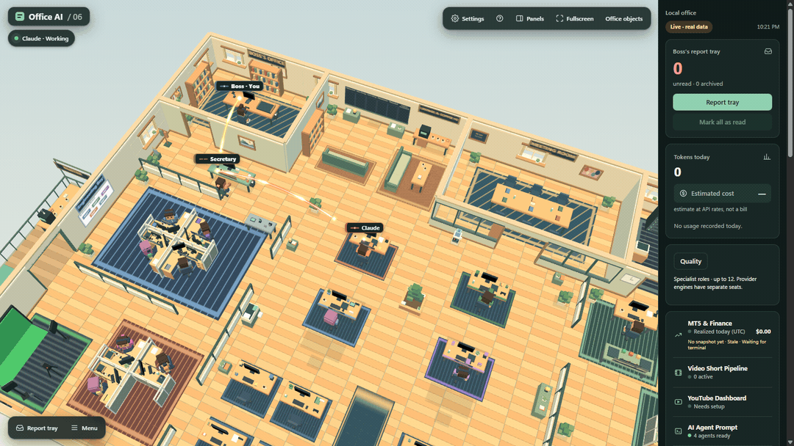

Karakter 3D memakai bentuk wajah, rambut, pakaian dan aksesori yang mengikuti pilihan avatar setiap agen. Kamera dekat menampilkan model terperinci. Tampilan menyeluruh dan Mode Hemat memakai geometri lebih ringan. Tekan **5** dengan pintasan bawaan untuk melihat Ruang Bos. [Lihat perbandingan model](shots/hd/perbandingan-karakter.jpg).

**Cara membaca sinar alur cahaya di atas kepala** ([Cara Kerja Alur Sinar Langsung](#cara-kerja-alur-sinar-langsung)):
- **Sinar emas bercahaya (`Bos -> Sekretaris`)**: Perintah diterima dan disalurkan langsung tanpa menahan alur, disertai pasangan denyut cahaya mengalir.
- **Oranye-koral (`Sekretaris -> Claude`)** · **Teal-sian (`Codex`)** · **Biru safir (`Gemini`)** · **Violet elektrik (`OpenCode`)** · **Amber terang (`Hermes`)**: Agen AI utama yang sedang bekerja dengan inti sinar terang, halo lembut additive, pendaran bintang kecil di simpul, dan aliran partikel cahaya berkelanjutan sehingga garis aktif tidak pernah tampak kaku.
- **Cabang persona spesialis** (mis. **Violet elektrik `Arsitek Perangkat Lunak`**, **Magenta neon `Desainer UI`**, **Teal-mint `Peneliti`**, **Merah kirmizi `Pemeriksa Realitas`**): Subagen nyata yang berjalan paralel—mode aksesibilitas membedakan peran lewat **ritme denyut & jarak partikel** (`aliran utuh` / `pasangan denyut` / `manik berkilau cepat`) plus lencana SVG mini pada setiap label simpul.
- **Kometa kembali hijau-putih + percikan tiba**: Hasil selesai melesat balik dengan kepala terang dan ekor cahaya meruncing dari anak -> induk -> Meja Bos, langsung memperbarui Baki Laporan (**Sinar merah berkedip putus-putus** = gagal atau batas kuota tercapai).

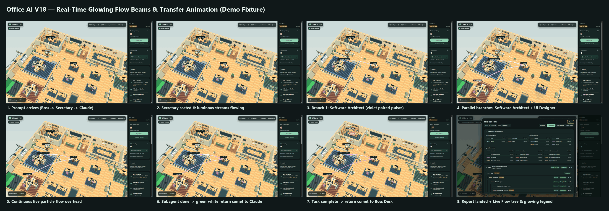

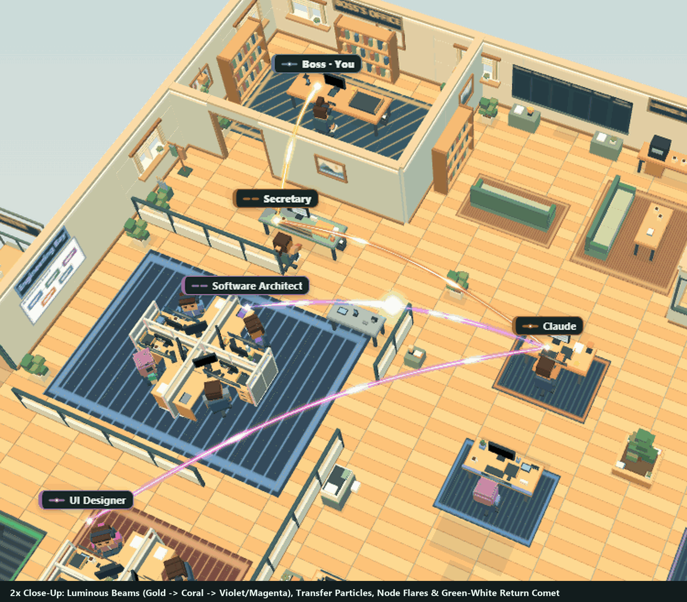

> *Potongan zoom 2× pohon sinar delegasi langsung yang memperlihatkan **Bos**, **Sekretaris** (sinar emas berdenyut ganda), **Claude** (sinar oranye-koral), **Software Architect** (sinar violet), dan **UI Designer** (sinar magenta) dengan pendaran bintang di simpul, lencana pola pada label, partikel cahaya mengalir, serta kometa kembali hijau-putih berekor menuju Claude. Lebar sinar (`Tipis` / `Normal` / `Tebal`) dan ritme aksesibilitas dapat diatur di **Pengaturan -> Alur**. Seluruh pratinjau memakai data demo/stub generik tanpa akun pribadi atau kunci rahasia. Bingkai penuh per tahap: [`flow_01.png`](docs/images/flow_01.png)–[`flow_08.png`](docs/images/flow_08.png).*

---

## Mulai Cepat (5 Langkah)

1. **Siapkan prasyarat:** Pasang **Node.js >= 18** (`node --version`). *(Opsional: Python 3.9+ untuk hook/MT5/Dasbor YouTube, serta CLI AI lokal seperti `claude`, `codex`, `agy`, `opencode`, atau `hermes`—atau cukup kunci Gemini API saja.)*
2. **Unduh repositori:**
   ```bash
   git clone https://github.com/FenomanSKY/Office-AI.git
   cd Office-AI
   ```
3. **Jalankan server lokal (tanpa perlu `npm install` untuk mode browser):**
   ```bash
   node embedded_server.js
   ```
   Buka URL yang tercetak di terminal (bawaan `http://127.0.0.1:8770`, otomatis pindah `8770–8775` jika port terpakai). *(Opsional jendela desktop Electron: jalankan `npm install && npm start`.)*
4. **Selesaikan Pusat Setup ("Mulai di sini"):** Pada peluncuran Live pertama, **Pusat Setup** terbuka otomatis. Pilih kandidat folder proyek (atau arahkan sendiri), uji koneksi CLI yang terpasang, masukkan kunci Gemini API bila ingin, dan atur bahasa/tema.
5. **Jalankan tugas atau Short pertama Anda:** Klik **Prompt Agen AI** untuk mengirim perintah langsung dari Meja Bos—atau buka **Studio Video**, pilih channel dari `Channels/`, tinjau rencana 8 tahap, lalu klik **Mulai produksi**.

---

## Ringkasan Fitur — Kapan Memakainya

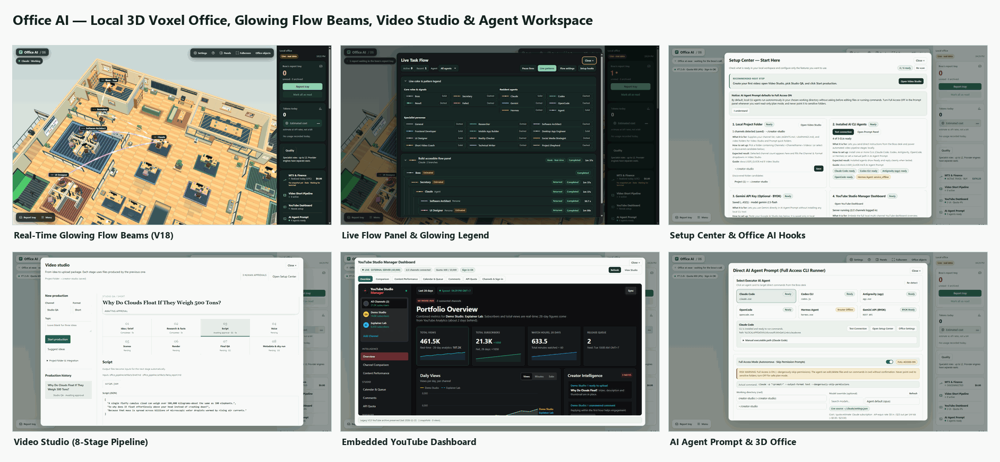

| Fitur | Kapan Memakainya |
|---|---|
| **Alur Tugas Langsung (Garis 3D)** | Pantau pohon delegasi nyata (**Bos -> Sekretaris -> Agen -> Persona Spesialis -> Paket kembali**) tampil dalam `<= 500 ms` dari hook Claude Code / Codex, Panel Prompt, atau Studio Video. |
| **Pusat Setup ("Mulai di sini")** | Saat pertama kali membuka aplikasi, atau saat memasang/mencabut hook Claude Code & Codex, menambah folder proyek, CLI agen, kunci Gemini, maupun Dasbor YouTube. |
| **Kantor Voxel 3D & Kamera** | Taruh di layar kedua untuk memantau agen utama, subagen (`P1..P8`), dan spesialis bekerja secara langsung. |
| **Baki Laporan & Hook Langsung** | Mengumpulkan laporan selesai otomatis lewat `collector.js`, `hook_send.py`, dan `office_event.py`. |
| **Bank Token & Perkiraan Biaya** | Total harian dan sepanjang riwayat lokal, peringkat penyedia/model/bulan dalam dropdown, impor penuh yang dapat dilanjutkan, serta estimasi biaya sesuai mata uang pilihan. |
| **Sayap Mutu & 12 Persona** | Menjalankan pemeriksaan mutu 3 ronde terstruktur dan menyetujui pelajaran di Lemari Pembelajaran. |
| **Persona: Bangun Anggota Tim AI Anda Sendiri** | Buat kerangka, validasi, dan ekspor persona spesialis kustom (`personas/`) ke Claude Code, Codex, Gemini, OpenCode, atau Hermes ([Panduan](docs/PERSONAS.id.md)). |
| **Studio Video (Pipa 8 Tahap)** | Memproduksi video Short dari ide sampai siap unggah dengan persetujuan manusia di Naskah (**G1**), QA/Pratinjau (**G2**), dan Upload (**G3**). |
| **Dasbor YouTube** | Memantau performa multi-channel, komentar baru, peringatan login OAuth, dan antrean rilis langsung di dalam Office AI. |
| **Prompt Agen AI** | Mengirim perintah langsung ke `claude`, `codex`, `agy`, `opencode`, `hermes`, atau `Gemini API BYOK` dengan pemilih model/effort. |
| **MT5 & Keuangan (Baca-Saja)** | Memantau posisi MetaTrader 5 secara aman (nol eksekusi order), mencatat kas multi-sumber, dan melihat kurva ekuitas. |
| **Obsidian Vault (Baca-Saja)** | Menjelajahi catatan Markdown lokal di dalam Office AI serta ekspor opsional rekap token harian (`Kantor/YYYY-MM-DD.md`). |
| **6 Bahasa + RTL** | Beralih instan antara `Bahasa Indonesia`, `English`, `Español`, `日本語`, `中文`, dan `العربية` (RTL). |

---

## Cara Kerja Alur Sinar Langsung

Alih-alih menunggu karakter berjalan membawa kertas sementara agen AI sungguhan sudah selesai menjawab, **Office AI** menggambar **sinar cahaya 3D real-time yang menyala di atas kepala** setiap pihak dengan efek transfer GPU yang selalu hidup:

1. **Prompt masuk:** Sinar cahaya lengkung (inti tipis terang + halo lembut additive + pendaran bintang di simpul) langsung tumbuh mulus dalam `<= 500 ms` dari **Bos -> Sekretaris -> Agen Utama** (`Claude`, `Codex`, `Gemini`, `OpenCode`, atau `Hermes`), dengan partikel cahaya mengalir searah penugasan. **Sekretaris** duduk mengetik di mejanya selama tugas aktif (non-blokir; gerak berjalan karakter tidak pernah menunda sinar atau laporan).
2. **Cabang delegasi subagen nyata & efek transfer hidup:** Saat CLI memanggil subagen atau persona spesialis nyata (mis. `Explore -> Peneliti`, `Plan -> Arsitek Perangkat Lunak`, `ui-designer -> Desainer UI`, atau pemetaan kustom di **Pengaturan -> Alur**), cabang sinar berwarna langsung memancar di atas kepala persona terkait. Saat bekerja maupun menunggu, shimmer lembut dan denyut partikel cahaya terus mengalir agar sinar tidak pernah tampak beku (tetap menghormati `walkAnimation: mati` sebagai sinar statis terang serta tombol Jeda/Lanjutkan di panel Alur).
3. **Kometa kembali, percikan tiba & laporan instan:** Saat subagen atau agen utama selesai, **kometa cahaya hijau-putih** (kepala sangat terang + ekor bercahaya meruncing) meluncur balik menyusuri jalur ke induk hingga ke Bos disertai percikan kecil di simpul tiba, langsung menambah Baki Laporan lalu memudar halus. Kegagalan atau batas pemakaian ditandai **sinar merah berkedip putus-putus**.
4. **Aksesibel (bukan hanya warna):** Setiap peran, penyedia, dan persona memadukan warna berkontras tinggi (`>= 3:1` pada tema Terang maupun Gelap) dengan **ritme denyut & jarak partikel** (`aliran utuh`, `pasangan denyut`, atau `manik berkilau cepat`) serta lencana SVG kecil di setiap label simpul. Buka **Alur Langsung** di sidebar/menu untuk melihat pohon delegasi yang dapat diperluas, menyaring agen, menjeda animasi, atau membuka **Legenda**.

### Sumber Event Real-Time vs. Tertunda per Agen

| Agen / Sumber | Mekanisme | Kecepatan / Lencana | Cabang Subagen |
|---|---|---|---|
| **Claude Code** | `hook_send.py` (`UserPromptSubmit`, `SubagentStart`, `SubagentStop`, `Stop`) | **Real-time (`<= 500 ms`)** · `Hook` | Cabang subagen nyata dipetakan ke persona |
| **Codex CLI** | `office_hook_codex.py` (`.codex/hooks.json` / notify) | **Real-time (`<= 500 ms`)** · `Hook` | Subagen yang teramati; satu garis agen jika tidak |
| **Panel Prompt Agen AI** | Adaptor server `runAgent` bawaan | **Real-time** · `Panel Prompt` | Persona terpilih yang benar-benar dijalankan |
| **Pipa Studio Video** | Adaptor tahap `runAgent` bawaan | **Real-time** · `Studio Video` | Hanya tahap AI nyata (tanpa persona palsu untuk render/audio) |
| **Gemini / OpenCode / Hermes** | Kolektor log baca-saja `collector.js` (atau CLI `office_event.py`) | **Tertunda** · `Kolektor Log` (`Perkiraan`) | Ditampilkan jujur sesuai log; pakai `office_event.py` untuk hook instan |

### Memasang & Mencabut Hook dengan Aman

- **Lewat antarmuka:** Buka **Menu -> Mulai di sini · Pusat Setup** lalu gulir ke bagian **Hook Office AI**. Pilih **Folder proyek saja** (disarankan) atau **Global**, klik **Pratinjau JSON persis**, periksa berkas yang akan ditulis, lalu konfirmasi **Pasang hook**. Cadangan bertanda waktu dibuat otomatis dan tombol **Cabut** mengembalikan konfigurasi awal dengan aman.
- **Lewat CLI (Python bawaan, tanpa `pip`):**
  ```bash
  python -I -B office_hooks.py preview --provider claude --scope project /jalur/folder-proyek
  python -I -B office_hooks.py install --provider claude --scope project /jalur/folder-proyek
  python -I -B office_hooks.py uninstall --provider claude --scope project /jalur/folder-proyek
  ```
- **Jaminan privasi & non-blokir:** Hook memakai `async: true`, timeout `1 dtk`, loopback murni (`127.0.0.1`), selalu `exit 0` diam-diam saat Office AI mati, dan **tidak pernah mengirim isi prompt penuh, keluaran terminal, atau rahasia**.

---

## Penjelasan Setiap Fitur & Pratinjau Visual

### 1. Kantor Voxel 3D Hidup (Mode Terang & Gelap)
- **Apa ini:** Kantor voxel Three.js `48×32 m + Teras Barat` dengan 10 ruangan tematik—Ruang Bos, Lobby Kanban Utara, Ruang Rapat Kaca, Obsidian Vault & Server Room, Engineering Bay, Studio Konten & Desain (dengan Green Screen), Area Inti AI, Boulevard Proyek 8 meja (`P1..P8`), Ruang Mutu & Dokumen, serta Ruang MT5 & Keuangan.
- **Masalah yang diselesaikan:** Sesi terminal multi-agen sulit dipantau sekaligus; dunia spasial 3D memperlihatkan seketika siapa yang sedang ngoding, memeriksa QA, santai, atau menunggu persetujuan Bos.
- **Tampilannya:** Tema terang dan gelap bergaya editorial arsitektural yang dioptimalkan `<= 340` draw call, lengkap dengan **Editor Tata Letak** drag-and-drop dan preset kamera per zona.

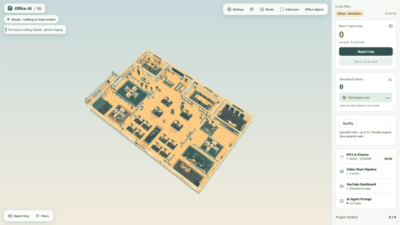

| Mode Terang | Mode Gelap |
|---|---|
|  | 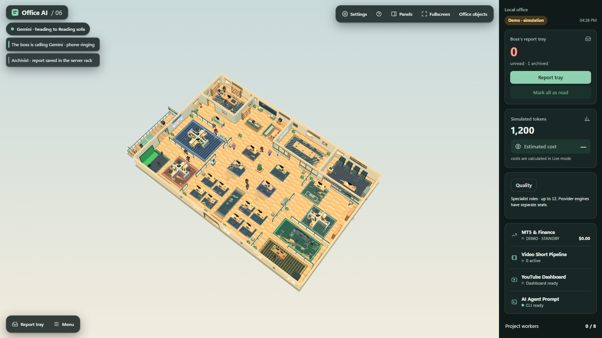 |

---

### 2. Pusat Setup ("Mulai di sini") & Penemuan Workspace Otomatis
- **Apa ini:** Daftar periksa penyiapan 6 baris yang didukung modul penemuan folder bertingkat baca-saja (`workspace_discovery.js`).
- **Masalah yang diselesaikan:** Menghilangkan dropdown kosong dan pesan galat membingungkan dengan mendeteksi folder proyek kreator (`Channels/*`), CLI terpasang, folder Dasbor YouTube terpisah, dan kunci API—dan **tidak pernah memilih otomatis secara diam-diam** bila ada lebih dari satu kandidat.
- **Tampilannya:** Kartu status nyata, spanduk **Langkah berikutnya yang disarankan** yang dinamis, pemberitahuan satu kali risiko **Mode Akses Penuh**, tombol simpan inline, dan pemilih folder asli di aplikasi Electron.

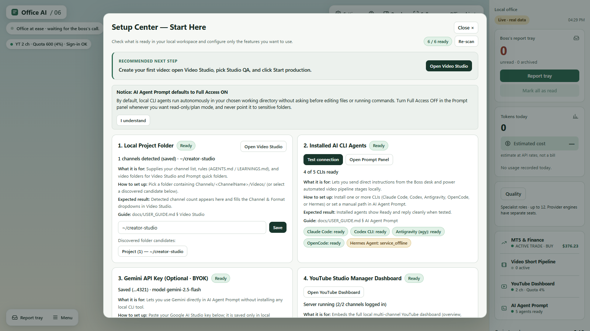

---

### 3. Baki Laporan, Hook Langsung & Bank Token
- **Apa ini:** Kotak masuk di Meja Bos yang terhubung ke `collector.js` (pemindai log sesi lokal baca-saja), `hook_send.py` (hook Claude Code `<0,5` detik, selalu `exit 0`), `office_event.py` (CLI lintas provider), serta penghitung perkiraan biaya token multi-mata uang.
- **Masalah yang diselesaikan:** Mencegah laporan subagen tenggelam di guliran terminal dan menjaga pemakaian token harian Claude, Codex, Gemini, serta Hermes tetap terlihat tanpa hitung ganda.
- **Tampilannya:** Lencana belum dibaca di Meja Bos 3D & sidebar, dialog Baki Laporan, grafik batang 7 hari, serta tabel tarif `pricing.json` yang dapat disunting dan selalu bertanda **ESTIMASI**.

<!-- [Diubah oleh Codex - 2026-11-22] -->
**Riwayat token V22:** Sidebar menampilkan **Total sejak …**. Buka **Paling banyak dipakai** untuk maksimal delapan peringkat penyedia/model/bulan, lalu **Lihat semua** untuk daftar lengkap, grafik 30/90 hari dan **Impor riwayat lokal lengkap**. Impor dapat dijeda dan diteruskan setelah restart. Hanya log yang masih tersedia di komputer ini yang dapat dihitung; log OpenCode belum didukung. [Cakupan dan perkiraan](docs/USER_GUIDE.id.md#riwayat-token-lokal-v22).

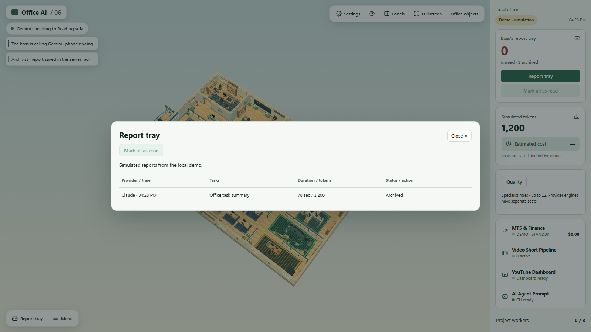

---

### 4. Sayap Mutu & 12 Persona Spesialis
- **Apa ini:** Siklus inspeksi QA terstruktur 3 ronde (`persona_call` -> `submit` -> `inspect_start` -> `verdict` -> `revise`/`learn`/`escalate`) yang dijalankan hingga 12 persona spesialis kustom dan seorang Manajer Mutu.
- **Masalah yang diselesaikan:** Membuat ronde revisi, persentase lolos pertama, eskalasi, dan cacat berulang menjadi terukur.
- **Tampilannya:** Spesialis berjalan mengantar hasil ke Meja Inspeksi (baki `IN`), lampu indikator menunjukkan lolos/gagal/revisi, dan catatan pembelajaran menunggu persetujuan Bos di **Lemari Pembelajaran**.

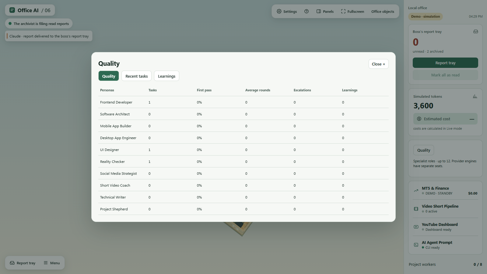

---

### 5. Studio Video (Pipa Nyata 8 Tahap & 3 Gerbang Manusia)
- **Apa ini:** Meja produksi video Short end-to-end (`ide` -> `naskah` -> `suara` -> `adegan` -> `render` -> `qa` -> `metadata` -> `upload`) dengan tiga gerbang persetujuan manusia wajib di **G1** (Naskah), **G2** (Pratinjau Video & QA), dan **G3** (Konfirmasi Upload Manual).
- **Masalah yang diselesaikan:** Mengotomasi tahapan produksi berulang sambil menjaga kendali kreatif dan keamanan publikasi di tangan manusia—lengkap dengan pra-pemeriksaan alat yang jujur dan nol auto-upload.
- **Tampilannya:** Pilihan channel dan format terisi otomatis dari `Tools/youtube/channels.json` atau subfolder `Channels/*`, jalur 8 tahap yang jelas, editor naskah bawaan di G1, pemutar video & bukti QA di G2, serta dialog konfirmasi unggah manual di G3.

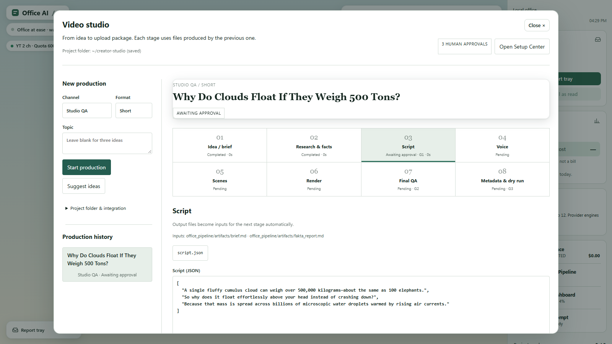

---

<!-- [Diubah oleh Gemini - 2026-11-21] Perbarui bagian Dasbor YouTube Tertanam V20 -->
### 6. Dasbor YouTube Studio Manager Tertanam
- **Apa ini:** Panel penuh yang menanamkan [YouTube Studio Manager](https://github.com/FenomanSKY/YouTube-Studio-Manager) (`Ringkasan`, `Komparasi`, `Performa Konten`, `Kalender & Antrean`, `Komentar`, `Kuota API`, `Channel & Login`) plus pil ringkas status di HUD 3D.
- **Masalah yang diselesaikan:** Menyatukan statistik multi-channel, peringatan kedaluwarsa OAuth, dan komentar baru langsung di Office AI—baik saat dasbor berada di folder proyek maupun di repo terpisah (`dashboardDir`)—dengan **font & ikon lokal 100% offline** (nol permintaan ke Google Fonts).
- **Tampilannya:** Mode tertanam Office AI (`?embed=office`) yang langsung mengikuti token tema Terang/Gelap Office AI secara real-time, menghilangkan sidebar & navigasi ganda sambil menyediakan pemilih channel ringkas + menu aksi cepat di atas, satu area gulir tanpa scrollbar bersarang, banner sukses hilang otomatis (~4 detik), status sinkronisasi segar/basi, serta panduan pasang 3 langkah bila belum diatur.

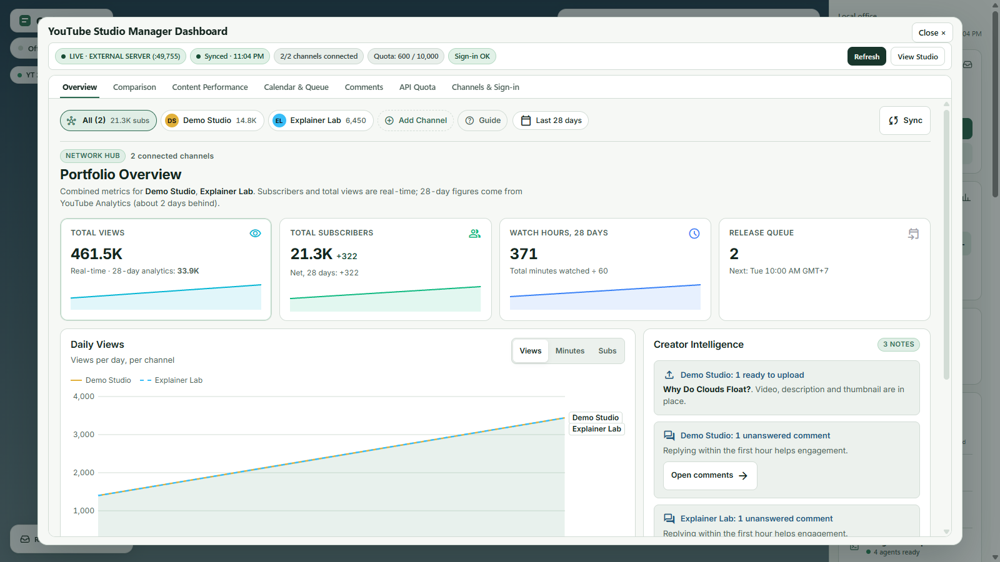

---

### 7. Prompt Agen AI (CLI Lokal & Gemini BYOK)
- **Apa ini:** Konsol perintah terpadu untuk 6 eksekutor (`Claude Code`, `Codex`, `Antigravity / Gemini`, `OpenCode`, `Hermes`, dan `Gemini API BYOK`) lengkap dengan pemilih model/effort, folder kerja otomatis, uji koneksi, dan streaming output SSE langsung.
- **Masalah yang diselesaikan:** Memungkinkan Anda mengirim tugas cepat ke agen terbaik tanpa berpindah banyak terminal—sambil memicu koreografi 3D Sekretaris mengantar brief ke meja residen.
- **Tampilannya:** Kartu status kesiapan agen, pemilih model bertingkat & effort, sakelar Full Access vs Mode Aman, pratinjau perintah, konsol streaming langsung, dan riwayat 50 eksekusi terakhir.

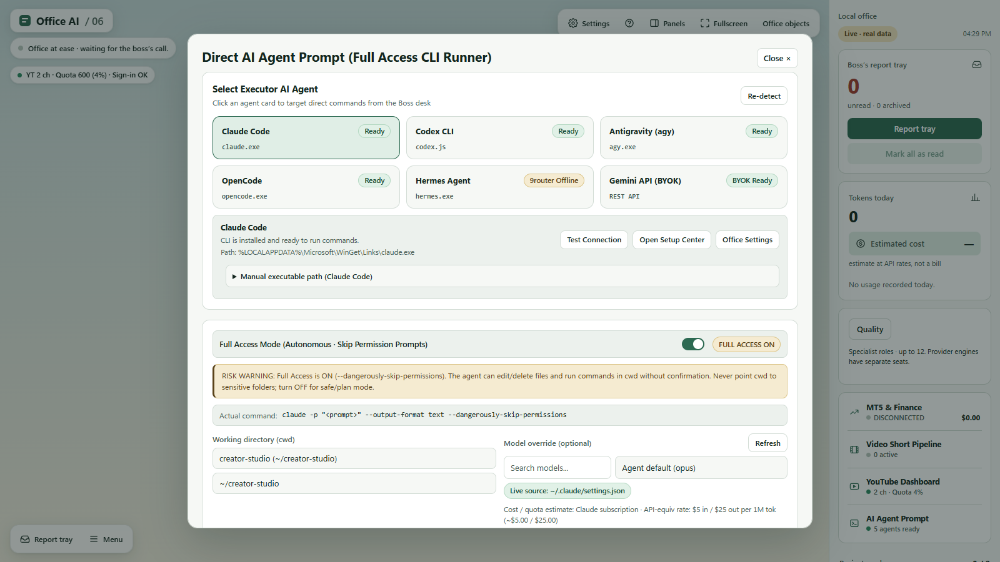

---

### 8. Pemantau MetaTrader 5 (100% Baca-Saja) & Keuangan Kantor
- **Apa ini:** Panel 3 tab yang menggabungkan pemantau MetaTrader 5 Windows baca-saja (`mt5_readonly_bridge.py`), buku besar kas kantor multi-sumber yang dimulai jujur dari `Rp 0` (`MT5`, `YouTube`, `Affiliate`, `Freelance`, `Lainnya`), serta tab Analisa Trading dengan ekspor CSV.
- **Masalah yang diselesaikan:** Memungkinkan trader memantau posisi aktif, membukukan deal tertutup terdeduplikasi, dan memeriksa Win Rate / Profit Factor / Drawdown / Kurva Ekuitas tanpa pernah memberi izin eksekusi order.
- **Tampilannya:** Meja 4 monitor Trader 3D dengan suar hijau/merah, kartu KPI, kurva ekuitas SVG, performa per simbol, kalender harian (heatmap), serta tombol **Simulasi Demo Trade** agar siapa pun dapat mencobanya tanpa memasang MT5.

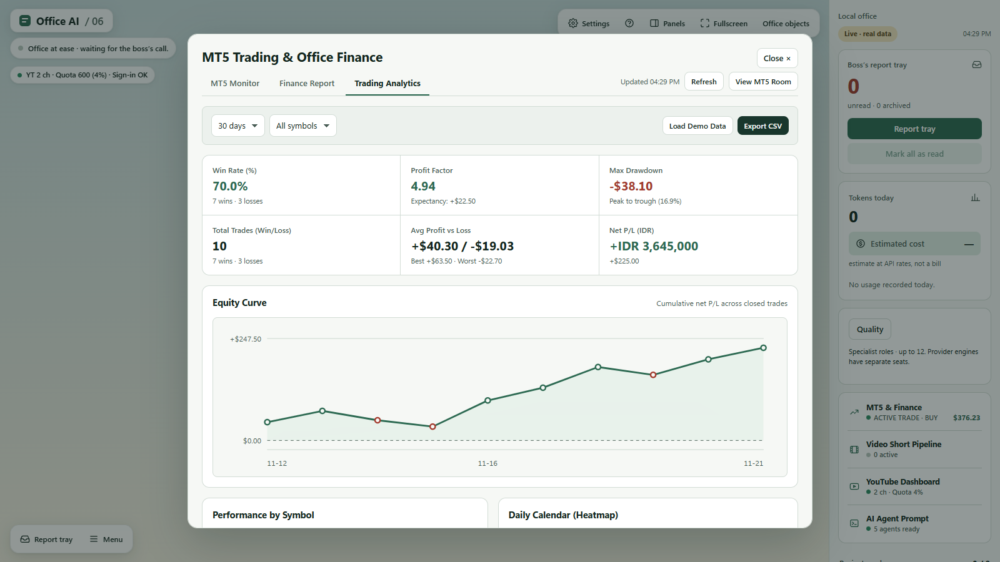

---

## Dokumentasi

- **Pengguna Akhir:**
  - [`docs/USER_GUIDE.id.md`](docs/USER_GUIDE.id.md) ([English](docs/USER_GUIDE.md)) — Panduan langkah demi langkah untuk setiap fitur.
  - [`docs/TROUBLESHOOTING.id.md`](docs/TROUBLESHOOTING.id.md) ([English](docs/TROUBLESHOOTING.md)) — Tabel Gejala -> Penyebab -> Perbaikan.
- **Pengembang & Agen AI:**
  - [`AGENTS.md`](AGENTS.md) — Manual otoritatif untuk agen AI (peta repo, arsitektur, batas keamanan, dan 5 langkah penyesuaian sesuai keinginan pemilik).
  - [`docs/PERSONAS.id.md`](docs/PERSONAS.id.md) ([English](docs/PERSONAS.md)) — Tata cara manusia dan agen AI membangun, memvalidasi, serta menerapkan persona spesialis (`personas/`, [Prompt](docs/prompts/BUILD_PERSONA_PROMPT.md)).
  - [`CLAUDE.md`](CLAUDE.md) & [`llms.txt`](llms.txt) — Titik masuk cepat bagi AI/LLM.
  - [`docs/ARCHITECTURE.md`](docs/ARCHITECTURE.md) — Diagram komponen dan alur event SSE.
  - [`docs/EXTENDING.md`](docs/EXTENDING.md) — 10 resep kustomisasi langkah demi langkah beserta perintah verifikasi.

---

## Jaminan Keamanan & Privasi

1. **100% Loopback Lokal (`127.0.0.1`), Tanpa Telemetri:** Office AI tidak mengirim data ke server pihak ketiga, menolak permintaan lintas situs lewat validasi `Host`/`Origin`/CSP ketat, dan memakai token per-proses 32-byte `X-Office-Token`.
2. **MetaTrader 5 Murni Baca-Saja:** `mt5_readonly_bridge.py` tidak pernah mengimpor/memanggil `order_send`/`order_check` maupun meminta password akun. Segala payload HTTP berisi kunci order/kredensial ditolak permanen dengan **HTTP 403**.
3. **Publikasi Selalu Lewat Persetujuan Manusia (Tidak Pernah Auto-Upload):** Studio Video selalu berhenti di **G1** (naskah), **G2** (QA & pratinjau video), dan **G3** (centang konfirmasi eksplisit + klik manual).
4. **Rahasia Terisolasi di Mesin Lokal:** Kunci BYOK opsional (`geminiApiKey`, `youtubeApiKey`) hanya tersimpan di `<dataDir>/secrets_local.json` (di luar repositori) dan selalu disamarkan (`...XXXX`) pada endpoint `GET`. Folder `Secrets/`, `.git`, symlink, dan path traversal (`..`) selalu ditolak.

---

## Lisensi

Dirilis di bawah **Lisensi MIT dengan Commons Clause** — lihat [`LICENSE`](LICENSE). Copyright (c) 2026 FenomanSKY. Boleh dipakai, disalin, diubah, dan dibagikan, tetapi **dilarang dijual** (termasuk menawarkan produk atau layanan berbayar yang nilainya berasal dari perangkat lunak ini). Ini lisensi source-available, bukan lisensi open source berstandar OSI. Komponen pihak ketiga tetap memakai lisensinya sendiri.

<!-- [Diubah oleh Codex - 2026-11-21] -->
## Sinkron MT5 otomatis (V17)

Office AI mendeteksi Python yang memiliki modul `MetaTrader5` (jalur tersimpan,
`py -3`, `python`, `python3`, lalu lokasi instalasi umum) dan terminal MT5 lokal.
Deteksi hanya mengimpor modul, tanpa membaca berkas akun. Jika keduanya ditemukan,
instalasi baru atau yang belum pernah diatur mengaktifkan sinkron otomatis.
Matikan melalui **Pengaturan → Umum → Sinkron MT5 otomatis** atau baris MT5 di
**Mulai di sini**. Pengaturan lanjutan pada MT5 & Keuangan menerima jalur Python,
jalur terminal, serta interval 1000–5000 ms (bawaan 1000 ms). **Uji sekarang**
mengulang deteksi dan pemeriksaan baca-saja.

Jembatan persisten melakukan initialize sekali per koneksi, mengirim snapshot,
dan mencoba sambung ulang dengan jeda bertahap 1–5 detik. Perubahan dikirim lewat
SSE; snapshot yang sama hanya mengirim detak ringan. Aliran macet/gagal dimulai
ulang; polling proses berurutan menjadi cadangan. Penutupan Office maupun proses
induk yang mati paksa menghentikan jembatan miliknya melalui Job Object Windows
V15. Nomor login dan sandi tidak diterima atau disimpan. Tidak ada pemanggilan
order, modifikasi, atau penutupan posisi. Login dilakukan di terminal MT5.

Tabel posisi memuat tiket, simbol, sisi, lot, harga buka/saat ini, SL/TP,
profit, swap, komisi masuk, dan net. **Net floating = profit + swap + komisi masuk
yang tersedia**. Komisi yang tidak diperoleh ditulis **n/a**; net tidak memasukkan
komponen yang belum diketahui itu. Pada penutupan sebagian, komisi masuk dibagi
sesuai volume tersisa. Angka trading menggunakan mata uang akun, 2 desimal.
Tambahan USD→IDR diberi label perkiraan; mata uang lain tidak dianggap USD.

**Terminal (ekuitas − saldo)** dan **Profit akun** merupakan pembacaan terminal
yang berbeda. Lencana cocok memakai ambang 0,02 mata uang akun; di luar itu
ditampilkan selisih bertanda. Komisi masuk mungkin sudah dipotong dari saldo,
sehingga net posisi yang memasukkannya dapat berbeda dari ekuitas dikurangi
saldo. Kredit, biaya tertahan, konversi mata uang dan waktu pembacaan yang berbeda
juga dapat memengaruhi hasil. Angka tidak dipaksa agar tampak cocok.

Saat ada posisi terbuka, tile sidebar menampilkan Net floating yang sama dengan
panel. Saat kosong, tile menampilkan **Realisasi hari ini (UTC)** dari deal trading
tertutup dalam mata uang akun. Angka itu berbeda dari saldo seluruh sumber pada
buku besar kantor. **Diperbarui N dtk lalu** dihitung dari snapshot terakhir;
status menjadi basi setelah 10 detik, termasuk saat koneksi/aliran berhenti.

Tombol **DEMO** memakai buku besar `mt5_demo.json` terpisah dan tidak mengubah
floating, analitik, atau saldo asli. Catatan lama bertanda `demo` dipindahkan dari
buku besar asli. Dalam mode live, hasil simulasi jelas berlabel DEMO; proyeksi
kantor asli tetap mengikuti snapshot asli.

Migrasi: `config.autoSyncDecided` menandai pilihan sinkron yang eksplisit.
`enabled:false` lama dengan semua nilai bawaan dianggap belum pernah diatur;
konfigurasi lama yang sudah disesuaikan dipertahankan sebagai opt-out. Pilihan
mati lama yang tersimpan persis seperti bawaan tidak dapat dibedakan dari data
yang belum disentuh; matikan sekali setelah update untuk mencatat pilihan tegas.
Cadangkan direktori data secara lokal sebelum kembali ke versi lama. Untuk
membatalkan sinkron, matikan opsi; pengaturan terminal tidak berubah.

Jika belum tersambung: buka MT5 dan login di sana; periksa status Python/modul/
terminal di Mulai di sini; pilih Uji sekarang; isi jalur Python atau terminal di
pengaturan lanjutan jika instalasi khusus belum ditemukan. MT5 bersifat opsional
dan ketiadaannya tidak menimbulkan galat saat membuka Office. Bila data basi,
periksa koneksi terminal ke broker lalu ulangi Uji sekarang. Paket Python tidak
dipasang otomatis.

Rujukan: [posisi dan swap](https://www.mql5.com/en/docs/python_metatrader5/mt5positionsget_py),
[riwayat posisi dan komisi](https://www.mql5.com/en/docs/python_metatrader5/mt5historydealsget_py),
[field akun](https://www.mql5.com/en/docs/python_metatrader5/mt5accountinfo_py),
[komponen ekuitas terminal](https://www.metatrader5.com/en/terminal/help/trading/report).
