<!-- [Diubah oleh Gemini - 2026-11-21] Public English README for Office AI V18 (luminous glowing flow beams & live transfer particles) -->
# Office AI

**A local-first 3D voxel office that turns your AI coding agents, real-time glowing overhead flow beams, Video Short production pipeline, YouTube dashboard, and read-only trading/finance trackers into one living desktop workspace—100% on `127.0.0.1` with zero telemetry.**

[English](README.md) · [Bahasa Indonesia](README.id.md) · [How Live Flow Works](#how-the-live-flow-works) · [User Guide](docs/USER_GUIDE.md) · [Troubleshooting](docs/TROUBLESHOOTING.md) · [AI Agent Manual (`AGENTS.md`)](AGENTS.md)

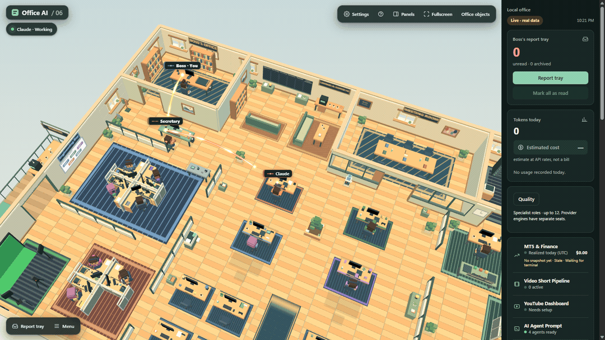

Staff use articulated character models with sculpted faces, hair, garments and accessories driven by each agent’s avatar settings. Close views use detailed meshes. The overview and Economy mode use lighter meshes. Press **5** with the default shortcuts to see the Boss’s Office. [Compare the character models](shots/hd/perbandingan-karakter.jpg).

**Reading the live glowing flow beams** ([How the Live Flow Works](#how-the-live-flow-works)):
- **Luminous gold beam (`Boss -> Secretary`)**: Prompt received and routed without blocking, with paired glowing pulses streaming along the arc.
- **Coral-orange (`Secretary -> Claude`)** · **Teal-cyan (`Codex`)** · **Sapphire blue (`Gemini`)** · **Electric violet (`OpenCode`)** · **Bright amber (`Hermes`)**: Main resident AI agent executing the task with an emissive core, soft additive halo, glowing star node flares, and continuous live transfer particles so active/working beams never look frozen.
- **Specialist persona branches** (e.g. **Electric violet `Software Architect`**, **Neon magenta `UI Designer`**, **Teal-mint `Researcher`**, **Crimson `Reality Checker`**): Real subagents spawned in parallel—accessibility mode distinguishes roles by **pulse rhythm & particle spacing** (`continuous stream` / `paired pulses` / `rapid sparkle beads`) plus compact SVG pattern badges on every node label.
- **Green-white return comet + arrival sparks**: Completed result flying back with a bright head and tapered luminous tail from child -> parent -> Boss Desk, updating the Report Tray immediately (**Blinking dashed red beam** = failed or usage limit reached).

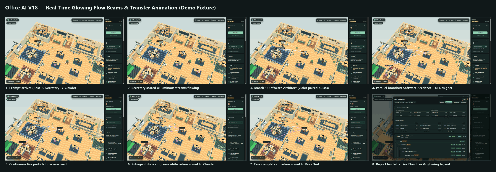

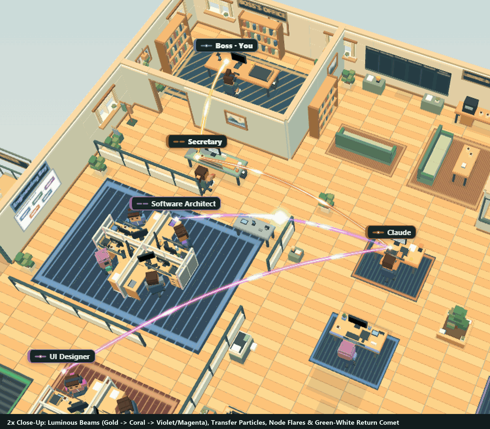

> *2× close-up of the live overhead glowing delegation tree showing **Boss**, **Secretary** (gold paired-pulse beam), **Claude** (coral-orange beam), **Software Architect** (violet beam), and **UI Designer** (magenta beam) with star node flares, pattern badges on labels, streaming transfer particles, and a bright green-white return comet with glowing tail flying back to Claude. Beam width (`Thin` / `Normal` / `Thick`) and accessibility rhythms can be adjusted in **Settings -> Flow**. All previews use synthetic demo/stub data—no personal accounts or private keys. Full-resolution frames: [`flow_01.png`](docs/images/flow_01.png)–[`flow_08.png`](docs/images/flow_08.png).*

---

## Quick Start (5 Steps)

1. **Check prerequisites:** Install **Node.js >= 18** (`node --version`). *(Optional: Python 3.9+ for hooks/MT5/YouTube dashboard, and any local AI CLI such as `claude`, `codex`, `agy`, `opencode`, or `hermes`—or just a Gemini API key.)*
2. **Download the repository:**
   ```bash
   git clone https://github.com/FenomanSKY/Office-AI.git
   cd Office-AI
   ```
3. **Start the local server (zero `npm install` needed for browser mode):**
   ```bash
   node embedded_server.js
   ```
   Open the URL printed in your terminal (default `http://127.0.0.1:8770`, auto-fallback `8770–8775`). *(Optional desktop window: run `npm install && npm start`.)*
4. **Complete the Setup Center ("Start here"):** On your first Live launch, **Setup Center** opens automatically. Confirm a discovered project folder (or pick one), test any installed CLI, optionally paste a Gemini API key, and set your language/theme.
5. **Run your first task or Short:** Click **AI Agent Prompt** to run a live prompt from the Boss Desk—or open **Video Studio**, pick a channel from `Channels/`, review the 8-stage plan, and click **Start production**.

---

## Feature Overview — When to Use Each Feature

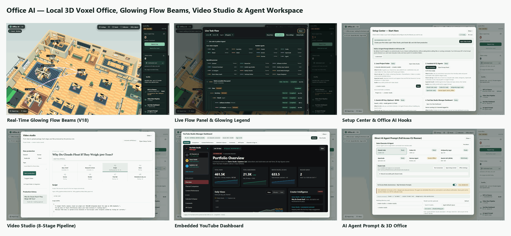

| Feature | When to Use It |
|---|---|
| **Live Task Flow (Overhead 3D Lines)** | Watch real-time delegation trees (**Boss -> Secretary -> Agent -> Specialist Personas -> Return packet**) appear in `<= 500 ms` from Claude Code / Codex hooks, Prompt Panel, or Video Studio. |
| **Setup Center ("Start here")** | First launch, or whenever you add a project folder, install/uninstall Claude Code or Codex hooks, test CLI agents, or add a Gemini key / YouTube dashboard folder. |
| **3D Voxel Office & Camera** | Keep open on a second monitor to watch agents, subagents (`P1..P8`), and specialists work in real time. |
| **Report Tray & Live Hooks** | Collect finished agent summaries automatically via `collector.js`, `hook_send.py`, and `office_event.py`. |
| **Token Bank & Cost Estimator** | Daily and lifetime local totals, compact provider/model/month rankings, resumable full-history import, and estimated API costs in your chosen currency. |
| **Quality Wing & 12 Personas** | Run structured 3-round QA inspections and approve reusable lessons in the Learning Cabinet. |
| **Personas: Build Your Own AI Team Members** | Scaffold, validate, and export custom specialist personas (`personas/`) to Claude Code, Codex, Gemini, OpenCode, or Hermes ([Guide](docs/PERSONAS.md)). |
| **Video Studio (8-Stage Pipeline)** | Produce Short videos end-to-end with mandatory human review at Script (**G1**), Preview/QA (**G2**), and Upload (**G3**). |
| **YouTube Dashboard** | Monitor multi-channel stats, comments, OAuth expiry alerts, and upload queues inside Office AI. |
| **AI Agent Prompt** | Send direct prompts to `claude`, `codex`, `agy`, `opencode`, `hermes`, or `Gemini API BYOK` with model/effort controls. |
| **MT5 & Office Finance (Read-Only)** | Monitor open MetaTrader 5 positions safely (zero order execution), log multi-source income/expenses, and view equity curves. |
| **Obsidian Vault (Read-Only)** | Browse local Markdown notes inside Office AI and optionally export daily token recaps (`Kantor/YYYY-MM-DD.md`). |
| **6 Languages + RTL** | Switch instantly between `English`, `Bahasa Indonesia`, `Español`, `日本語`, `中文`, and `العربية` (RTL). |

---

## How the Live Flow Works

Instead of waiting for characters to walk across the office carrying paper while fast AI agents have already answered, **Office AI** renders **real-time glowing 3D light beams** anchored above every participant's head with continuous GPU-driven transfer effects:

1. **Prompt arrives:** A curved emissive light beam (bright core + soft additive halo + star node flares) grows smoothly within `<= 500 ms` from **Boss -> Secretary -> Resident Agent** (`Claude`, `Codex`, `Gemini`, `OpenCode`, or `Hermes`), with luminous particles streaming in the dispatch direction. The **Secretary** sits at her desk and types while the task is active (non-blocking; character walking never delays beams or reports).
2. **Real subagent delegation & living transfer flow:** When a CLI spawns real subagents or specialist personas (for example `Explore -> Researcher`, `Plan -> Software Architect`, `ui-designer -> UI Designer`, or custom mappings you edit in **Settings -> Flow**), color-coded glowing branches fork directly above the called personas' heads. Even while working/waiting, subtle shimmer and flowing light pulses keep active beams visibly alive (respecting `walkAnimation: off` as bright static beams and panel Pause/Resume).
3. **Return comet, arrival sparks & instant report:** When a subagent or main agent finishes, a **green-white luminous comet** (bright head + tapered glowing tail) flies back along the exact edges to the parent and up to the Boss with micro arrival sparks at each node, immediately updating the Report Tray before fading away cleanly. Failures or usage limits pulse as a **blinking dashed red beam**.
4. **Accessible by design:** Every provider, role, and persona pairs a high-contrast color (`>= 3:1` in Light and Dark themes) with a distinct **pulse rhythm / particle spacing** (`continuous stream`, `paired pulses`, or `rapid sparkle beads`) and a compact SVG badge on every node label. Open **Live Flow** from the sidebar or menu to inspect expandable delegation trees, filter by agent, pause animations, or open the interactive **Legend**.

### Real-Time vs. Delayed Event Sources

| Agent / Source | Mechanism | Latency / Label | Subagent Branches |
|---|---|---|---|
| **Claude Code** | `hook_send.py` (`UserPromptSubmit`, `SubagentStart`, `SubagentStop`, `Stop`) | **Real-time (`<= 500 ms`)** · `Hook` | Real subagent spawns mapped to personas |
| **Codex CLI** | `office_hook_codex.py` (`.codex/hooks.json` / notify) | **Real-time (`<= 500 ms`)** · `Hook` | Observable subagents; single agent line otherwise |
| **AI Agent Prompt Panel** | Built-in `runAgent` server adapter | **Real-time** · `Prompt Panel` | Real selected persona when invoked |
| **Video Studio Pipeline** | Built-in stage `runAgent` adapter | **Real-time** · `Video Studio` | Only real AI stages (never fake branches for render/audio) |
| **Gemini / OpenCode / Hermes** | Read-only `collector.js` session logs (or manual `office_event.py`) | **Delayed** · `Log Collector` (`Estimated`) | Shown honestly as observed; use `office_event.py` for instant hooks |

### Installing & Uninstalling Hooks Safely

- **In the UI:** Open **Menu -> Start here · Setup Center** and scroll to **Office AI Hooks**. Pick **Project folder only** (recommended) or **Global**, click **Preview exact JSON**, inspect the exact file content, then confirm **Install hook**. A timestamped backup is saved automatically and **Uninstall** restores your original file cleanly.
- **Via CLI (stdlib Python, zero `pip`):**
  ```bash
  python -I -B office_hooks.py preview --provider claude --scope project /path/to/your-project
  python -I -B office_hooks.py install --provider claude --scope project /path/to/your-project
  python -I -B office_hooks.py uninstall --provider claude --scope project /path/to/your-project
  ```
- **Privacy & non-blocking guarantees:** Hooks run with `async: true`, `1 s` timeout, loopback-only (`127.0.0.1`), always `exit 0` silently if Office AI is closed, and **never send full prompt text, terminal output, or secrets**.

---

## Feature Walkthrough & Visual Previews

### 1. Living 3D Voxel Office (Light & Dark Modes)
- **What it is:** A `48×32 m + West Terrace` Three.js voxel headquarters with 10 thematic rooms—Boss Room, North Kanban Lobby, Glass Meeting Room, Obsidian Vault & Server Room, Engineering Bay, Content & Design Studio (with Green Screen), Central AI Core, 8-desk Project Boulevard (`P1..P8`), Quality & Docs Wing, and MT5 & Finance Wing.
- **Problem it solves:** Multi-agent terminal sessions are hard to track at a glance; a spatial 3D world lets you see immediately who is coding, inspecting, idle, or waiting on your approval.
- **What it looks like:** Crisp architectural editorial light and dark themes batched under `<= 340` draw calls, with drag-and-drop furniture editing (`Layout Editor`) and camera zone presets.

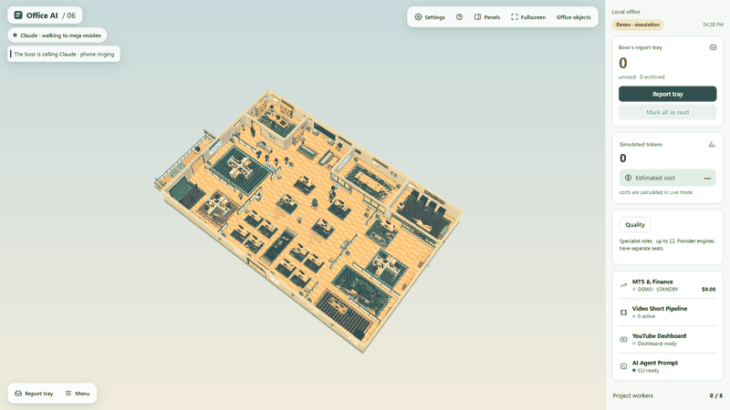

| Light Mode | Dark Mode |
|---|---|
|  | 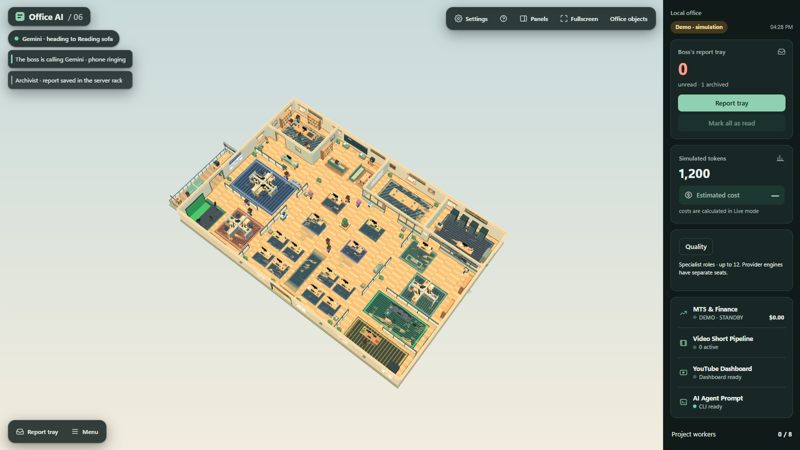 |

---

### 2. Setup Center ("Start here") & Automatic Workspace Discovery
- **What it is:** A guided 6-row onboarding hub powered by tiered read-only workspace discovery (`workspace_discovery.js`).
- **Problem it solves:** Eliminates blank dropdowns and cryptic startup errors by detecting creator project folders (`Channels/*`), installed CLIs, separate YouTube Dashboard repos, and API keys—while **never silently guessing** when multiple candidate folders exist.
- **What it looks like:** A clean status checklist with a dynamic **Recommended Next Step**, one-time **Full Access** risk notice, inline folder/key actions, and a native folder picker in Electron.

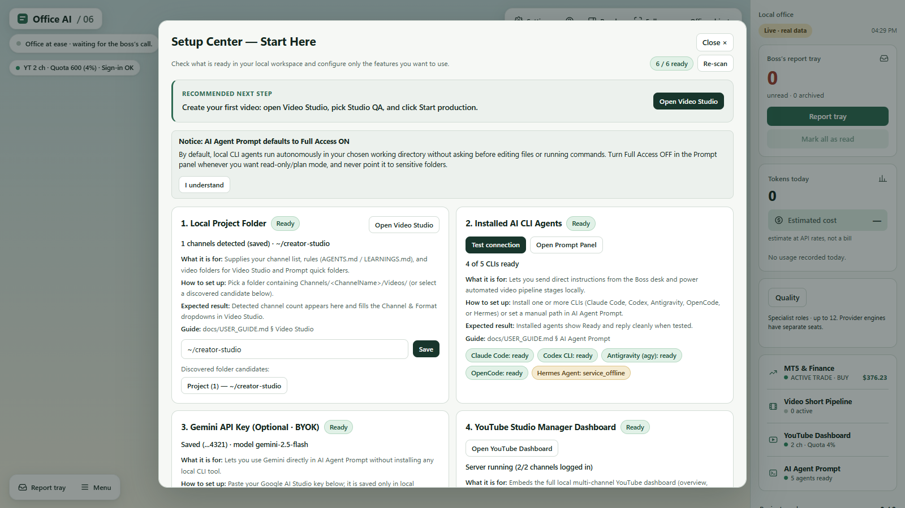

---

### 3. Report Tray, Live Hooks & Token Bank
- **What it is:** An inbox at the Boss Desk paired with `collector.js` (read-only local session scanner), `hook_send.py` (Claude Code hook, `<0.5s`, always `exit 0`), `office_event.py` (cross-provider CLI), and a multi-currency token/cost estimator.
- **Problem it solves:** Prevents finished background subagent outputs from getting buried in scrollback and keeps daily and lifetime token usage visible across Claude, Codex, Gemini, and Hermes without double-counting.
- **Lifetime history (V22):** The sidebar shows **Total since …**. Expand **Most used** for up to eight provider/model/month rankings, then **See all** for a paginated list, 30/90-day chart and **Import full local history**. Imports can be paused and resumed after restart. Only available logs on this computer can be counted; OpenCode usage logs are not supported. [Coverage, estimates and recovery](docs/USER_GUIDE.md#local-token-history-v22).
- **What it looks like:** Unread count badges on both the 3D Boss Desk and sidebar, a filterable Report Tray dialog, 7-day daily usage bars, and an editable `pricing.json` table clearly marked **ESTIMATE**.

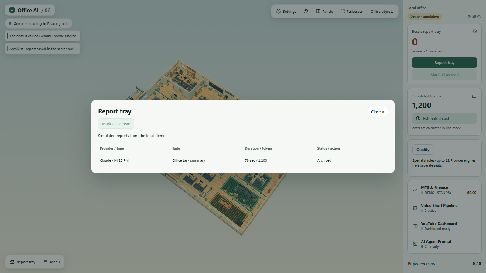

---

### 4. Quality Wing & 12 Specialist Personas
- **What it is:** A 3-round QA inspection cycle (`persona_call` -> `submit` -> `inspect_start` -> `verdict` -> `revise`/`learn`/`escalate`) staffed by up to 12 customizable voxel specialists and a Quality Manager.
- **Problem it solves:** Makes review loops, first-pass rates, escalations, and recurring defects measurable instead of ad-hoc.
- **What it looks like:** Specialists physically deliver drafts to the Inspection Desk (`IN` tray), traffic-light indicators signal pass/fail/revise, and pending lessons wait for your approval in the **Learning Cabinet**.

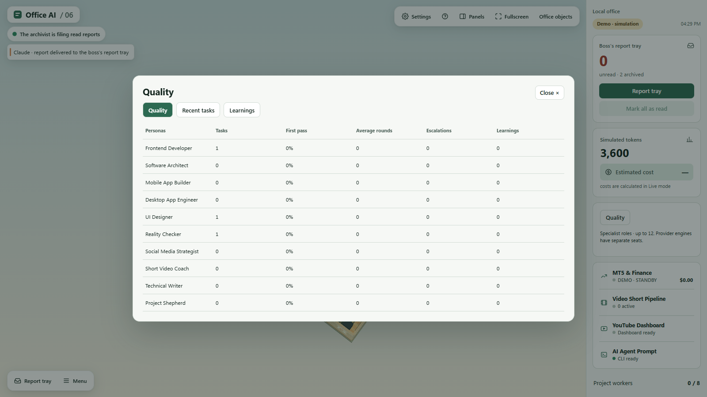

---

### 5. Video Studio (8-Stage Real Pipeline & 3 Human Gates)
- **What it is:** An end-to-end production desk for short-form video channels (`idea` -> `script` -> `audio` -> `scene` -> `render` -> `qa` -> `metadata` -> `upload`) with mandatory human gates at **G1** (Script), **G2** (Video Preview & QA), and **G3** (Explicit Manual Upload Confirmation).
- **Problem it solves:** Automates repetitive multi-stage production while keeping creative control and publishing safety firmly in human hands—with honest pre-run tool checks and zero silent auto-uploads.
- **What it looks like:** Channel and format selectors populated automatically from `Tools/youtube/channels.json` or `Channels/*` subfolders, a clear 8-stage progress rail, built-in script editor at G1, embedded video & QA evidence viewer at G2, and a guarded manual publish dialog at G3.

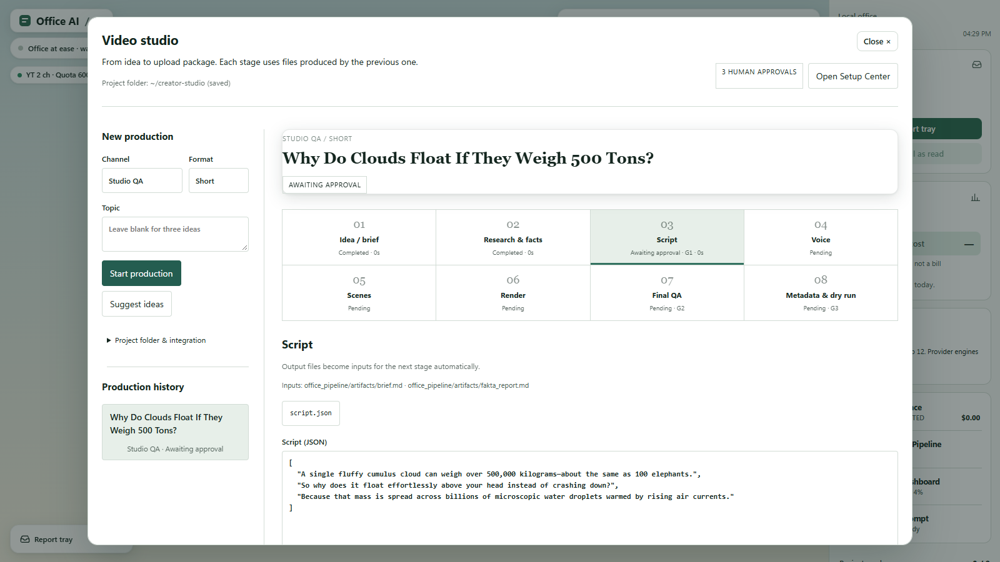

---

<!-- [Diubah oleh Gemini - 2026-11-21] Perbarui bagian Dasbor YouTube Tertanam V20 -->
### 6. Embedded YouTube Studio Manager Dashboard
- **What it is:** A full-panel embedded host for [YouTube Studio Manager](https://github.com/FenomanSKY/YouTube-Studio-Manager) (`Overview`, `Comparison`, `Content Performance`, `Calendar & Queue`, `Comments`, `API Quota`, `Channels & Sign-in`) plus a live HUD summary pill.
- **Problem it solves:** Brings multi-channel YouTube health, OAuth sign-in expiry warnings, and viewer comment alerts right inside Office AI—whether the dashboard lives in your project folder or in a separate repo (`dashboardDir`)—with **100% self-hosted local fonts/icons** (zero external Google Fonts requests).
- **What it looks like:** Native Office AI embedded mode (`?embed=office`) that automatically follows Office AI's Light and Dark design tokens in real time, hides duplicate navigation/branding while keeping a compact top channel switcher & quick-action bar, provides a single scroll area without nested scrollbars, auto-dismisses startup banners, displays live fresh/stale sync status, and falls back to a 3-step install guide when not yet configured.

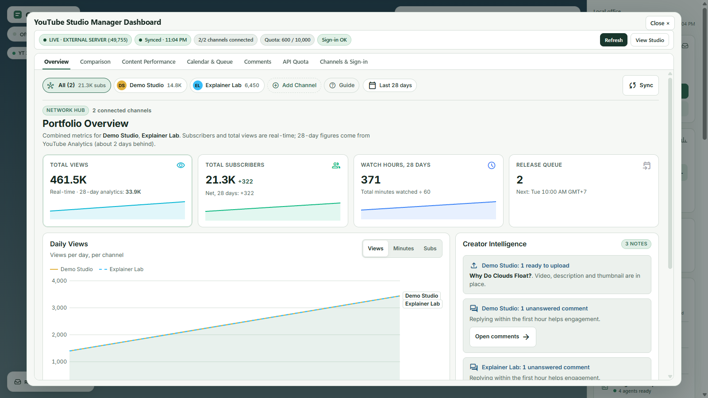

---

### 7. AI Agent Prompt (Direct Local CLI & Gemini BYOK)
- **What it is:** A unified command console for 6 executors (`Claude Code`, `Codex`, `Antigravity / Gemini`, `OpenCode`, `Hermes`, and `Gemini API BYOK`) with model/effort selection, auto-discovered working directories, connection testing, and live SSE streaming.
- **Problem it solves:** Lets you dispatch quick tasks to whichever AI agent fits best without juggling six terminal windows—while triggering 3D Secretary -> Resident handoff choreography.
- **What it looks like:** Provider readiness cards, hierarchical model & effort pickers, Full Access vs Safe Mode toggle, command preview bar, live streaming output console, and a 50-run history list.

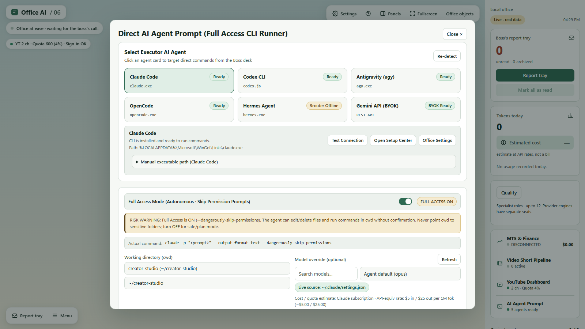

---

### 8. MetaTrader 5 Monitor (Strictly Read-Only) & Office Finance
- **What it is:** A 3-tab wing pairing a 100% read-only Windows MetaTrader 5 monitor (`mt5_readonly_bridge.py`), an honest `0`-initial-balance multi-source office ledger (`MT5`, `YouTube`, `Affiliate`, `Freelance`, `Other`), and a Trading Analytics dashboard with CSV export.
- **Problem it solves:** Lets traders monitor open positions, auto-book deduplicated closed deals, and inspect Win Rate / Profit Factor / Drawdown / Equity Curves without ever granting order-execution access.
- **What it looks like:** A 4-monitor 3D Trader desk with green/red signal beacon, live KPI cards, SVG equity curve, symbol performance table, daily heatmap, and built-in **Demo Trade Simulation** so anyone can test it without MT5 installed.

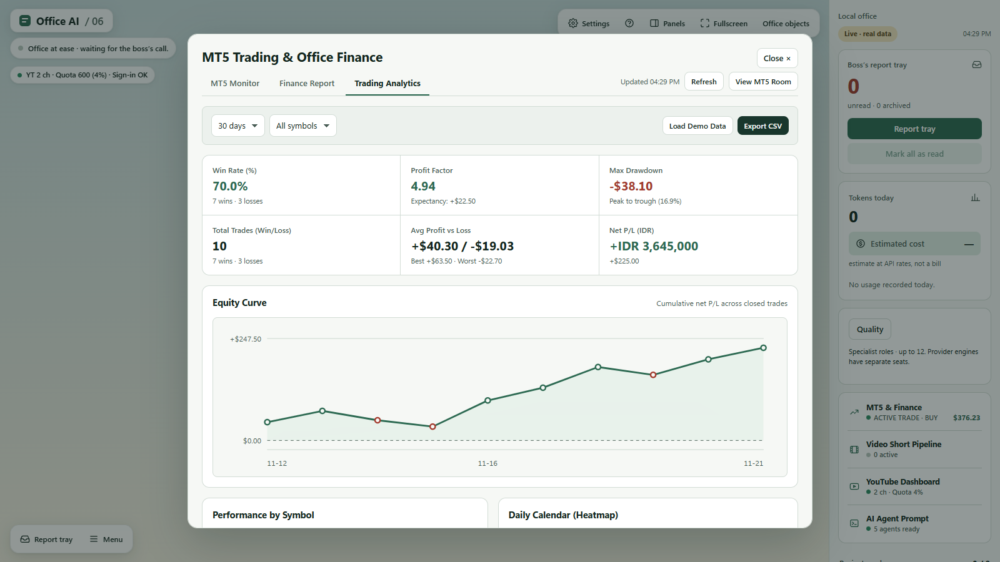

---

## Documentation

- **End Users:**
  - [`docs/USER_GUIDE.md`](docs/USER_GUIDE.md) ([Bahasa Indonesia](docs/USER_GUIDE.id.md)) — Step-by-step guide for every feature.
  - [`docs/TROUBLESHOOTING.md`](docs/TROUBLESHOOTING.md) ([Bahasa Indonesia](docs/TROUBLESHOOTING.id.md)) — Symptom -> Cause -> Fix table.
- **Developers & AI Agents:**
  - [`AGENTS.md`](AGENTS.md) — Authoritative AI-agent repo map, architecture, safety boundaries, and 5-step owner-adaptation procedure.
  - [`docs/PERSONAS.md`](docs/PERSONAS.md) ([Bahasa Indonesia](docs/PERSONAS.id.md)) — How humans and AI agents build, validate, and apply specialist personas (`personas/`, [Prompt](docs/prompts/BUILD_PERSONA_PROMPT.md)).
  - [`CLAUDE.md`](CLAUDE.md) & [`llms.txt`](llms.txt) — Fast AI/LLM entrypoints.
  - [`docs/ARCHITECTURE.md`](docs/ARCHITECTURE.md) — Component & SSE event diagrams.
  - [`docs/EXTENDING.md`](docs/EXTENDING.md) — 10 step-by-step customization recipes with verification commands.

---

## Security & Privacy Guarantees

1. **100% Local Loopback (`127.0.0.1`), Zero Telemetry:** Office AI never phones home, never bundles third-party analytics, and blocks cross-site requests with strict `Host`/`Origin`/CSP guards and a per-process 32-byte `X-Office-Token`.
2. **Strictly Read-Only MetaTrader 5:** `mt5_readonly_bridge.py` never imports or calls `order_send`/`order_check` and never asks for broker passwords. Any HTTP payload containing trading or credential keys is permanently rejected with **HTTP 403**.
3. **Human-Gated Publishing (Never Auto-Uploads):** Video Studio always stops at **G1** (script), **G2** (QA & video preview), and **G3** (explicit checkbox + manual upload confirmation).
4. **Local Isolated Secrets:** Optional BYOK API keys (`geminiApiKey`, `youtubeApiKey`) are stored exclusively in `<dataDir>/secrets_local.json` (outside the repository) and always masked (`...XXXX`) on `GET` endpoints. `Secrets/`, `.git`, symlinks, and path traversal (`..`) are rejected across every store and CLI runner.

---

## License

Released under the **MIT License with the Commons Clause** — see [`LICENSE`](LICENSE). Copyright (c) 2026 FenomanSKY. You may use, copy, modify and share it, but you may not **sell** it (including offering a paid product or service whose value derives substantially from this software). This is a source-available license, not an OSI-approved open-source license. Third-party components keep their own licenses.

<!-- [Diubah oleh Codex - 2026-11-21] -->
## MT5 automatic sync (V17)

Office AI detects a Python interpreter with the `MetaTrader5` module (saved path,
`py -3`, `python`, `python3`, then common installation directories) and a local MT5
terminal. Detection only imports the module; it does not read account files.
When both are found, a new or previously unconfigured installation enables
automatic sync. **Settings → General → Automatic MT5 sync** and the MT5 row in
**Start here** provide the same explicit opt-out. Advanced connection settings
in MT5 & Finance accept a Python executable, terminal path, and a 1000–5000 ms
interval (default 1000 ms). **Test now** repeats detection and a read-only check.

The persistent bridge initializes once per connection, streams JSON snapshots,
and reconnects with 1–5 second backoff. Changed snapshots reach the interface via
SSE; unchanged snapshots use a small heartbeat. A stalled or failed stream is
restarted, with serialized process polling as fallback. Office shutdown and
parent-process crashes terminate the owned bridge using the V15 Windows Job
Object. No account password or login number is accepted or stored. There are no
order, modification or position-closing calls. Log in through MT5 itself.

Each position shows ticket, symbol, side, lot size, opening/current price, SL/TP,
profit, swap, entry commission and net. **Net floating = profit + swap + available
entry commission**; an unavailable commission is **n/a**, and net then excludes
that unknown component. After partial closure, entry commissions are allocated
to remaining volume. All trading amounts use the account currency and 2 decimals.
An additional USD→IDR figure is explicitly approximate; other account currencies
are never silently treated as USD.

**Terminal (equity − balance)** and **Account profit** are separate terminal
readings. The comparison badge matches within 0.02 account-currency units and
shows the signed difference otherwise. Entry commission may already have been
charged to balance, so including it in position net can legitimately differ from
equity minus balance. Credit, blocked charges, currency conversion and readings
at slightly different moments can also explain a difference. The interface does
not force either figure to equal the other.

With an open position, the sidebar displays the same Net floating as the panel.
Otherwise it displays **Realized today (UTC)**, from closed trading deals in the
account currency. This is distinct from the office ledger's all-source balance.
**Updated N s ago** counts from the last received snapshot; data becomes stale
after 10 seconds, including when the connection or stream stops.

**DEMO** buttons use a separate `mt5_demo.json` ledger and never change real
floating, analytics or office balances. Old records marked `demo` are migrated
out of the real ledger. In live mode, simulation results are explicitly labelled
DEMO; the real office projection follows real snapshots.

Migration: `config.autoSyncDecided` records an explicit sync decision. Legacy
`enabled:false` with unchanged defaults is treated as never configured; customized
legacy settings are conservatively preserved as an opt-out. An old intentional
disable saved with exactly the original defaults is indistinguishable from an
untouched default; turn it off once after updating to record the explicit choice.
Keep a local backup of the data directory before reverting versions. To undo the
sync preference, turn it off; no terminal settings are changed.

If sync is unavailable: open MT5 and log in there; check Python/module/terminal
statuses in Start here; run Test now; select the correct interpreter or terminal
in advanced settings if discovery misses a custom installation. Missing MT5 is
optional and does not generate a startup error. For stale data, check that the
terminal is connected to its broker and retry Test now. No Python packages are
installed automatically.

Reference: [positions and swap](https://www.mql5.com/en/docs/python_metatrader5/mt5positionsget_py),
[position deal history and commissions](https://www.mql5.com/en/docs/python_metatrader5/mt5historydealsget_py),
[account fields](https://www.mql5.com/en/docs/python_metatrader5/mt5accountinfo_py),
[terminal equity components](https://www.metatrader5.com/en/terminal/help/trading/report).
