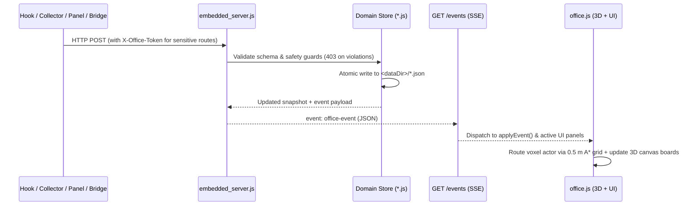

<!-- [Diubah oleh Gemini - 2026-11-21] Architecture overview & data-flow diagrams for Office AI (updated for V16 live overhead flow lines) -->
# Office AI Architecture

Office AI is a local-first web and Electron desktop application that renders an interactive 3D voxel office (`48×32 m + West Terrace`) driven by real-time local events over Server-Sent Events (SSE).

---

## 1. High-Level Component Topology

```mermaid
flowchart TB
  subgraph Desktop["Optional Electron Shell"]
    MAIN["main.js<br/>Single-instance, loopback guard,<br/>safe office:pick-folder IPC"]
    PRE["preload.js<br/>window.officeDesktop"]
  end

  subgraph Server["Embedded Local Server (127.0.0.1:8770..8775)"]
    SRV["embedded_server.js<br/>Host/Origin/CSP guard + X-Office-Token<br/>+ /flow/state &amp; /flow/hooks/*"]
    FLOW["office_flow_model.js + office_flow_map.json<br/>Bounded event projection &amp; palette"]
    DISC["workspace_discovery.js<br/>Tiered project & dashboard discovery"]
    DATA["office_data.js + collector.js<br/>Usage, reports, pricing, Obsidian read-only"]
    QUAL["quality_store.js + settings_store.js<br/>12 personas & 3-round QA"]
    SHORT["short_pipeline.js + short_workflow_store.js<br/>8-stage Short pipeline + G1/G2/G3 gates"]
    YT["youtube_dashboard_host.js + youtube_analytics_store.js<br/>Embedded dashboard host + legacy archive"]
    PROMPT["agent_prompt_store.js<br/>Direct local CLI & Gemini BYOK runner"]
    MT5["mt5_finance_store.js + mt5_readonly_bridge.py<br/>Read-only MT5 (HTTP 403 write guard) + ledger"]
  end

  subgraph Client["Browser / Renderer (index.html)"]
    THREE["office.js + office_flow3d.js + furniture.js + chars.js<br/>Three.js 48x32 m world, GPU luminous overhead flow beams (&lt;=340 draw calls)"]
    SPEC["office_specialists.js + specialist_wing.js<br/>12 specialist desks & inspection desk"]
    UI["Panels: office_flow_ui.js, office_setup_ui.js, office_short_ui.js,<br/>office_youtube_ui.js, office_v12_ui.js,<br/>office_v13_ui.js, office_panels.js, office_settings_ui.js"]
    I18N["i18n.js + locales/*.json (6 languages + RTL)"]
  end

  subgraph External["Local Machine Only (No Cloud Telemetry)"]
    HOOKS["hook_send.py / office_hook_codex.py / office_hooks.py / office_event.py"]
    CLIS["Local CLIs: claude, codex, agy, opencode, hermes"]
    PROJ["Creator Workspace: Channels/*/Videos/"]
    DASH["Separate or Project YouTube Studio Manager (server.py)"]
    TERM["MetaTrader 5 Desktop (Windows, Read-Only)"]
  end

  MAIN --> SRV
  MAIN --> PRE
  PRE --> UI
  SRV <-->|"HTTP REST + SSE /events"| THREE
  SRV <-->|"HTTP REST + X-Office-Token"| UI
  THREE <--> SPEC
  UI <--> I18N
  SRV --> DISC
  SRV --> DATA
  SRV --> QUAL
  SRV --> SHORT
  SRV --> YT
  SRV --> PROMPT
  SRV --> MT5
  HOOKS -->|"POST /event"| SRV
  SHORT -->|"short_process_runner.py"| PROJ
  SHORT --> CLIS
  PROMPT --> CLIS
  YT -->|"HTTP loopback iframe"| DASH
  MT5 -->|"Python stdlib/MT5 read-only"| TERM
```

---

## 2. Event & Choreography Flow

### Core SSE Event Families (`event: office-event`)
- **Live Overhead Flow Beams (V16/V18):** `flow_event` (separate `flow_revision` namespace for collector-superseded hook lifecycles so token/report accounting never double-counts), plus standard `call`, `spawn`, `retire`, `report`, `prompt_run_started`/`prompt_run_done`, and Video Studio stage events projected immediately through `OfficeFlowModel` into `OfficeFlow3D` (emissive GPU ribbon beams, additive bloom, streaming transfer particles, star node flares, return comets with arrival sparks, `<=500 ms` event-to-first-beam latency) and `OfficeFlowUI`.
- **Agent & Subagent Activity:** `call`, `report`, `spawn`, `retire`, `usage`, `usage_updated`.
- **Specialist Quality Cycle:** `persona_call`, `submit`, `inspect_start`, `verdict`, `revise`, `learn`, `escalate`.
- **Video Studio (8-Stage Real Pipeline & Demo Workflow):** `short_run_update`, `short_stage_log`, `workflow_update`, `workflow_deleted`, `workflow_config`.
- **YouTube Dashboard:** `youtube_dashboard_status`, `youtube_dashboard_summary`, `youtube_login_warning`, `youtube_new_comment`.
- **AI Agent Prompt:** `prompt_run_started`, `prompt_run_chunk`, `prompt_run_done`.
- **MT5 & Finance:** `mt5_state`, `mt5_deal_closed`, `finance_updated`.

---

## 3. Data Directory Resolution (`<dataDir>`)

Runtime state is always isolated outside the source tree when packaged, and customizable via environment variables:

1. `OFFICE_AI_DATA_DIR` (highest priority — recommended for tests and custom setups)
2. `OFFICE_DATA_DIR` (legacy alias)
3. Electron default: `%APPDATA%/OfficeAI/data/` (or `<root>/runtime/OfficeAI/data/` when launched with `--office-workspace`)
4. Node server mode default: `<office-ai-root>/data/`

| File in `<dataDir>` | Purpose |
|---|---|
| `port.txt` | Active loopback port (`8770..8775`) read automatically by `hook_send.py` and `office_event.py`. |
| `state.json` | Report tray entries, daily token/cost totals, deduplicated event IDs. |
| `settings.json` | Language, theme, text size, currency, collector switches, custom furniture layout, 12-slot persona roster. |
| `setup_state.json` | Setup Center first-run dismissal (`dismissed`) and one-time Full Access risk acknowledgment (`fullAccessAck`). |
| `pricing.json` | Estimated USD per 1M token tariffs and exchange rates. |
| `quality.json` | Specialist task history (capped at 2000), inspection rounds, and Learning Cabinet items. |
| `short_workflows.json` | Shared workspace config (`localProjectDir`, `dashboardDir`, `defaultChannel`, `geminiModel`) and demo workflows. |
| `short_runs.json` | Real 8-stage Video Studio run state, gate status, and artifact hashes. |
| `mt5_finance.json` | Read-only MT5 config, deduplicated closed deals, trading analytics history, and honest `0`-balance ledger. |
| `prompt_runs.json` | Last 50 direct CLI prompt runs (metadata + output excerpts). |
| `secrets_local.json` | Local-only BYOK keys (`geminiApiKey`, `youtubeApiKey`). Never served raw on `GET`, never stored in repo. |
| `config.json` | Optional read-only `vaultRoot` for the Obsidian Vault viewer (edit only while server is stopped). |

---

## 4. Security & Isolation Boundaries

- **Loopback Only (`127.0.0.1`):** Rejects non-loopback `Host`, invalid `Origin`, and `Sec-Fetch-Site: cross-site`. Strict CSP prevents external script loading and sets `frame-ancestors 'none'` + `X-Frame-Options: DENY`. Only the configured local dashboard loopback origin is allowed in `frame-src`.
- **Per-Process CSRF Token (`X-Office-Token`):** Generated as 32 random bytes on every server startup, injected into `index.html`, and verified with `crypto.timingSafeEqual` on write/sensitive routes.
- **Path & Secret Protection:** `workspace_discovery.js`, `short_pipeline.js`, `agent_prompt_store.js`, `office_data.js`, and `main.js` block `Secrets`, `.git`, symlinks/junctions, ADS (`:`), and traversal (`..`).
- **Strictly Read-Only MT5:** `mt5_readonly_bridge.py` imports no order-execution calls, and `assertReadOnlyPayload` rejects any request carrying trading/credential keys with `HTTP 403`.
- **Human-Gated Publishing:** Video Studio stops at **G1** (Script), **G2** (QA & Video Preview), and **G3** (Explicit confirmation checkbox + button before any upload script can run).

<!-- [Diubah oleh Codex - 2026-11-22] V21 physical subagent endpoints -->
## 5. Subagent Endpoints / Ujung Subagen

The model retains the observed `agentType` and stable child ID even when its persona falls back to `general`. The browser binds each `(flow ID, node ID)` to an available mapped specialist or a temporary project worker. Busy, disabled, missing, and unmapped specialists use the same temporary-worker path. Workers share the existing pool of eight `project-*` desks, enter through the door, follow the existing collision-aware walking and gait code, and leave after the return animation. Missing desks use clear standing work points. `full`, `fast`, and `off` control movement without delaying the flow event.

When the pool or entrance is occupied, a child remains attached to its leader's real head with a `+N` badge. Selecting the badge opens the expanded Flow tree, which retains every child ID and observed type. Nodes never use unoccupied floating coordinates. The renderer checks anchors at runtime, warns once for a missing anchor, and asks the host to recover to a real parent. Completed-only events get a short endpoint/return lifecycle; historical completed flows loaded on reconnect do not summon workers again.

Model menyimpan jenis dan ID anak asli. Browser memakai persona yang tersedia atau pekerja sementara dari pool delapan meja proyek; pekerja masuk dari pintu, bekerja, lalu keluar setelah paket kembali. Saat pool atau pintu sibuk, `+N` menempel pada kepala induk dan membuka pohon Alur berisi semua identitas anak. Jenis tak dikenal, persona sibuk/nonaktif, dan stop tanpa start tetap mempunyai ujung yang terlihat. Mode jalan lengkap/cepat/mati tidak menunda garis; hidrasi riwayat selesai tidak memanggil pekerja ulang.

Claude/Codex hooks carry observed lifecycle events. Gemini and Hermes log fixtures exercise the existing read-only collector and remain explicitly estimated/delayed. OpenCode currently has no native log parser in `collector.js`; an explicitly supplied observed event can use `source: 'log'`, but the UI does not infer subagents from unobserved tool activity. Run `node qa/v21_subagent_test.cjs` for real hook/SSE, seeded physical endpoint checks, pool overflow, and eventual worker cleanup.
