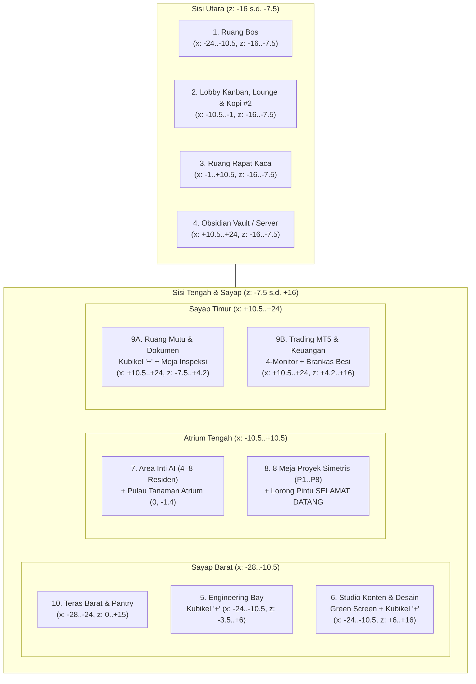
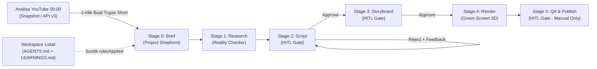

<!-- [Diubah oleh Gemini - 2026-11-20] Menyusun PRD lengkap Office AI (V1 s.d. V13 + Hotfix) menggunakan skill create-prd (phuryn/pm-skills) mencakup strategi produk, JTBD, desain 3D voxel 48x32 m, sistem desain UI/UX, fitur fungsional, arsitektur teknis, keamanan, QA, dan rencana rilis -->
# PRD — Office AI (Kantor Voxel 3D Lokal untuk Orkestrasi Agen AI, Trading MT5 Baca-Saja, Keuangan Kantor, Analisa YouTube & Otomasi Video Short)

| Atribut | Nilai |
|---|---|
| **Nama Produk** | Office AI (Desktop Electron · Windows x64) |
| **Versi Dokumen** | `1.0` — Baseline Lengkap (Revisi 1 s.d. **Revisi 13 + Hotfix**) |
| **Tanggal** | `2026-11-20` |
| **Status** | Terbangun, terverifikasi 100% (QA otomatis + visual), dan terkemas (`OfficeAI.exe`, 41 berkas runtime) |
| **Kerangka PRD** | `create-prd` (`phuryn/pm-skills`, 8 bagian standar diperluas atas permintaan pengguna ke spesifikasi desain & teknis lengkap) |
| **Distribusi** | Siap publik (*local-first*, tanpa telemetri cloud, 0 path pribadi, dokumentasi AI-ready) |

---

## 1. Ringkasan Eksekutif (Summary)

**Office AI** adalah aplikasi desktop lokal (*local-first*, Electron + Three.js) yang mengubah pemantauan dan pengendalian berbagai agen AI (**Claude Code**, **Codex**, **Gemini / Antigravity**, **OpenCode**, **Hermes**), pemantauan akun **MetaTrader 5** baca-saja, pembukuan **Keuangan Kantor**, analisa **YouTube Channel**, serta alur produksi **Video Short 6-tahap (HITL)** ke dalam satu ruang kantor voxel 3D berukuran **48×32 m + Teras Barat 4×15 m**. Produk ini dibangun bagi *solo builder*, pengembang multi-agen, operator studio konten YouTube, dan *retail trader* yang kelelahan berpindah-pindah antar-terminal CLI, log JSON, spreadsheet keuangan, dan tab analitik tanpa visibilitas menyeluruh. Saat ini, di era agen AI lokal yang berjalan paralel sepanjang hari, pengguna membutuhkan satu pusat komando visual yang aman, 100% lokal (`127.0.0.1`), transparan pada estimasi biaya token, dan tegas pada batas kendali manusia (*Human-in-the-Loop*).

---

## 2. Pemangku Kepentingan & Peran (Contacts & Ownership)

| Peran | Tanggung Jawab Utama | Catatan |
|---|---|---|
| **Pemilik Produk (Product Owner / Bos)** | Menetapkan visi ruang 3D, preferensi estetika anti-slop, keputusan arsitektur (Full Access prompt, auto-reset YouTube 00:00, MT5 baca-saja), persetujuan pratinjau tata letak, dan uji langsung `OfficeAI.exe`. | Pemegang keputusan akhir untuk semua perubahan publik dan rilis. |
| **Tim Multi-Agen Rekayasa (Codex / Claude / OpenCode / Gemini Antigravity)** | Merancang arsitektur, membangun kode 3D/backend/UI, melakukan inspeksi visual, menjalankan seluruh suite pengujian otomatis, dan mengemas `OfficeAI.exe` secara idempoten. | Bekerja berdasarkan kontrak `AGENTS.md`, `CLAUDE.md`, dan `REPORT.md`. |
| **Pengguna Publik & Agen AI Eksternal** | Memasang, mengonfigurasi, dan memperluas Office AI di perangkat masing-masing (mode demo instan maupun mode live dengan BYOK/CLI lokal). | Menggunakan `README.md`, `AGENTS.md`, `CLAUDE.md`, dan `docs/SETUP_GUIDE.md`. |

---

## 3. Latar Belakang & Evolusi Produk (Background & Progress V1 → V13)

### 3.1 Konteks Masalah & Mengapa Sekarang (*Why Now*)
Pengembang dan kreator masa kini tidak lagi menjalankan satu chatbot tunggal, melainkan mengorkestrasi beberapa agen CLI sekaligus (**Claude Code**, **Codex CLI**, **Antigravity / `agy`**, **OpenCode**, **Hermes**) secara paralel bersama otomasi konten YouTube dan sistem trading algoritmik di MetaTrader 5. Namun pengalaman kerjanya masih terpecah:
- Aktivitas agen tersembunyi di jendela terminal teks; pengguna sulit melihat agen mana sedang sibuk, menunggu persetujuan, atau menganggur.
- Konsumsi token harian dan perkiraan biayanya tersebar di log lokal berbagai provider (termasuk varian model Gemini baru yang belum terhitung).
- Pemantauan posisi MT5, laporan laba/rugi usaha lintas sumber, analitik performa channel YouTube harian, dan status pipeline produksi Video Short berada di aplikasi terpisah tanpa alur terpadu.

Kematangan Three.js berbasis *instanced mesh* (draw call sangat rendah di GPU integrasi/SwiftShader), Electron lokal yang terisolasi di `127.0.0.1`, serta standar hook/log lokal CLI agen AI memungkinkan seluruh alur kerja ini disatukan ke satu aplikasi desktop ringan yang bekerja 100% di mesin pengguna tanpa server cloud.

### 3.2 Kronologi Lengkap Progres Pembuatan (Awal s.d. Akhir)

| Fase / Revisi | Fokus & Terobosan Utama | Status |
|---|---|---|
| **V1 – V3 (Fondasi Web 3D & Desain Awal)** | Prototipe kantor voxel 3D Three.js di browser, karakter animasi dasar, baki laporan, dan arah desain *architectural paper + warm wood*. | Selesai (arsip awal) |
| **V4 (Desktop Electron & Pengaturan)** | Kemasan desktop Electron (`main.js`, `embedded_server.js`), penyimpanan atomik (`office_data.js`), penjelajah Obsidian Vault baca-saja, editor harga token, kontrol kamera bebas (orbit/pan/zoom/WASD), dan panel pengaturan lengkap. | Selesai |
| **V5 (Sistem Desain UI & HUD Kaca)** | Token CSS semantik (Light/Dark), HUD kaca buram (*glass toolbar*), lencana notifikasi baki, animasi angka *tabular-nums*, mode hemat (*economy*), dan *reduced motion*. | Selesai |
| **V6-A, V6-B, V6-C, V6-I (Kolektor, Dunia Affordance, Roster & 6 Bahasa)** | Kolektor log lokal baca-saja (`collector.js` untuk Claude, Codex/Orca, Gemini/Antigravity, Hermes), dunia berbasis *affordance* (18 aktivitas objek nyata + komputer mati saat nganggur + seret-lepas karakter), roster agen residen dapat dikustomisasi (1–8 kursi) + tooltip hover, dan mesin lokalisasi **6 bahasa** (`id`, `en`, `es`, `ja`, `zh-CN`, `ar` RTL) + `I18n.draw` pada kanvas 3D. | Selesai |
| **V7 (Hermes, Editor Tata Letak & Aksesibilitas)** | Agen residen Hermes ke-4, editor tata letak 3D interaktif (`office_layout.js`), navigasi keyboard antar-objek (`Ctrl+O` + Tab), dan audit keamanan ketat (CSP, Origin/Host guard, `X-Office-Token`). | Selesai |
| **V9 (Fisika Footprint Tunggal & Pembersihan Folder)** | Sistem *footprint* tunggal (`OfficeWorldObjects`) + overlay *Garis Fisik* (`Ctrl+G`) menghilangkan 100% benturan karakter/perabot, perbaikan `NaN laporan`, semua benda inti bisa dipindah, dan perapian akar folder (`00_Office AI.lnk`, `Aplikasi/`, `docs/`, `cadangan/`). | Selesai |
| **V10 (Divisi Spesialis & Jalur Mutu 3 Ronde)** | Menambahkan 10 persona spesialis (`personas.json`, `quality_store.js`, `office_specialists.js`), Manajer Mutu, siklus inspeksi–revisi–eskalasi 3 ronde, papan Kanban 3D, Lemari Pembelajaran (Setujui/Tolak), serta revisi UI Baki Laporan + Menu vertikal bergulir + pelat nama kontekstual. | Selesai |
| **Revisi 11 / V11 (Penghapusan Sayap Kanan)** | Menghapus sayap kanan lama dan memindahkan seluruh 10 persona spesialis (+ 2 slot cadangan = 12 workstation) ke dalam kantor utama dengan 5 pod bersekat rendah; memperbaiki migrasi `layout_rules.js`, relokasi Kanban & Papan Harian bebas halangan, dan memperbaiki *deadlock* `giveWay` di ambang pintu. | Selesai |
| **Revisi 12 / V12 (Ekspansi 48×32 m, Kubikel `+`, MT5, Keuangan & Video Short)** | Pratinjau 3D `preview_v12_layout.html` di-ACC pengguna → ekspansi kantor ke **48×32 m + Teras Barat 4×15 m**, 10 zona tematik, **3 klaster kubikel modular `+` kaca buram**, dekorasi kaya (`518` prop, `34` tempat sampah, Pulau Tanaman Atrium), `0` karpet tumpang tindih (`26` karpet), otonomi *idle* lintas 36 fasilitas untuk semua agen, **Agen Trader MT5 (Read-Only)** + **Agen Keuangan Kantor** (saldo awal jujur `Rp 0` & serah slip profit/rugi ke brankas), **Workflow Video Short 6-tahap HITL** (Folder Lokal + BYOK Gemini + graf SVG + koreografi Green Screen), dan dokumentasi distribusi publik (`0` path pribadi). | Selesai |
| **Revisi 13 / V13 (Workspace Sync, YouTube 00:00, Prompt Agen Full Access, MT5 Analytics & Cost Gemini)** | Estimasi biaya token Gemini lengkap (`31` model + pencocok prefix/tier + `recordExternalUsage()`), **Analisa Trading MT5 Lengkap** (1–365 hari, 6 KPI, Kurva Ekuitas SVG, Heatmap harian, per-simbol, CSV RFC-4180), **Sinkronisasi Workspace Proyek** (`AGENTS.md`/`LEARNINGS.md`/`ACTIVE.md`/`Channels/*`, skip `Secrets/`) ke 6 tahap Short, **Analisa YouTube Channel + Auto-Reset `00:00` & Catch-Up** (`yt_snapshots/YYYY-MM-DD.json`, 3 rekomendasi + tombol 1-klik `Buat Tugas Short`), serta **Panel Prompt Agen AI Langsung** (6 agen *whitelisted*, Full Access default ON, streaming SSE, koreografi 3D Sekretaris → residen). | Selesai |
| **V13 Hotfix (Pasca-Uji Langsung Pengguna)** | Memperbaiki 2 bug produksi lapangan + 2 ketidaksinkronan MT5: (1) pencocokan deal pembuka `DEAL_ENTRY_IN` per `position_id` agar arah `SELL`/`BUY` tidak terbalik, komentar EA (`Drift2`/`NY_Momentum`/`Drift`) ikut tersinkron, nomor tiket cocok dengan MT5 History, auto-rekonsiliasi ledger lama, bebas drift kurs USD (`$346.40`), kolom `Net (IDR)` selalu literal Rupiah, dan tanggal Heatmap sinkron tanggal ISO broker; (2) pelepasan rute `/prompt/*` dari `serial()` global + state machine `upsertRunSafe()`/`sendingPrompt`/`cancellingRunId` agar pembatalan prompt saat proses berjalan instan (<10 ms) dan tidak pernah macet loading atau mengunci pengiriman berikutnya. | Selesai & Terkemas |
| **V8 (Unggah Benda 3D / Mode Karton-Voxel)** | Unggah model 3D kustom ke kantor (`docs/briefs/V8_UPLOAD3D.md`). | Ditunda ke rilis berikutnya |

---

## 4. Tujuan & Hasil Utama Terukur (Objective & SMART Key Results)

### 4.1 Tujuan Produk (Objective)
Menyediakan **satu ruang komando desktop 3D lokal yang hidup, cepat, aman, dan siap disebarluaskan** sehingga pengguna (dan agen AI mereka) dapat memantau, memerintah, mengevaluasi mutu, melacak biaya token & laba usaha, serta memproduksi konten Video Short dalam satu antarmuka visual tanpa kehilangan kendali keamanan atau privasi.

### 4.2 Hasil Utama Terukur (Key Results — Terverifikasi pada Baseline V13 + Hotfix)

| ID | Key Result (SMART) | Target | Realisasi Terukur (V13 + Hotfix) |
|---|---|---|---|
| **KR-1 (Kinerja 3D & Stabilitas Gerak)** | Menjaga kompleksitas grafis & fisika pada ruang `48×32 m` dengan 22 aktor permanen dan `518` properti dekorasi. | `drawCalls <= 340`, `0` pelanggaran tabrakan/rute pada simulasi `600` detik, `0` tumpang tindih karpet (`minGap >= 0.25 m`). | **Tercapai:** `drawCalls = 279–300`, `0` pelanggaran dari `268.570` sampel aktor (`v10_browser_test` 45/45), `0` tumpang tindih dari `26` karpet (`minGap = 0.30 m`). |
| **KR-2 (Keamanan Keras & Privasi Publik)** | Memastikan tidak ada eksekusi trading MT5, tidak ada unggah otomatis YouTube, tidak ada kebocoran `Secrets` atau path pribadi, serta semua mutasi dilindungi token & validasi. | `100%` payload order/kredensial ditolak HTTP `403`, `0` path pribadi pada seluruh berkas publik, `0` XSS/`innerHTML`, `autoApprove: false` pada gerbang HITL. | **Tercapai:** `37` kunci terlarang MT5 ditolak `403`, `Secrets`/`.git` ditolak `403`, `0` temuan privasi di 18 berkas runtime/dokumen publik, `0` `innerHTML`, `0` error konsol. |
| **KR-3 (Keandalan Alur Kerja & Responsivitas)** | Seluruh fitur inti V4–V13 (Kolektor, Mutu, MT5 Analytics + Auto-Reconcile, Keuangan, Short 6-tahap, YouTube 00:00 Catch-Up, Prompt Runner + Cancel) lulus uji E2E & regresi penuh. | `100%` lulus di seluruh suite QA otomatis, Cancel prompt `< 50 ms` tanpa macet loading, dan kemasan `repack.py` 2× idempoten cocok SHA-256. | **Tercapai:** `v13_full_test` **24/24**, `v12_full_test` **34/34**, `v7_browser_test` **431/431** (`225/225` Tab), `v10_api_test` **69/69**, `v7_api_test` **41/41**, `v10_store_test` **16/16**, `v10_packaged_check` **41/41** SHA-256 & **31/31** HTTP `200`. |
| **KR-4 (Aksesibilitas Global & Anti-Slop UI)** | Mendukung 6 bahasa penuh (termasuk RTL Arab) dan tema Terang/Gelap tanpa tumpang tindih label atau teks tak diterjemahkan. | `0` kunci i18n hilang/galat di 6 bahasa, `0` kegagalan lint visual Light/Dark `1600×900`. | **Tercapai:** `1.167` kunci teraudit (`1.212` entri total) × `6` bahasa (`0` error), 19 tangkapan layar V12+V13 lolos inspeksi visual. |

---

## 5. Segmen Pasar / Target Pengguna (Market Segments)

Segmen didefinisikan berdasarkan pekerjaan nyata (*Jobs-to-be-Done*) yang sedang diselesaikan pengguna, bukan demografi:

1. **Segmen A — Pengembang & *Solo Builder* Multi-Agen Lokal**
   - *Pekerjaan:* Menjalankan Claude Code, Codex CLI, Antigravity/Gemini, OpenCode, dan Hermes secara paralel untuk membangun perangkat lunak, memantau progres subagen, mengaudit mutu hasil, dan menjaga biaya token harian tetap terkendali.
   - *Batasan:* Tidak mau mengirim kode sumber atau log sesi ke server SaaS pihak ketiga; butuh jalan lokal di Windows dengan CPU/GPU standar.
2. **Segmen B — Operator Studio Konten YouTube Shorts Berbantuan AI**
   - *Pekerjaan:* Mengelola satu atau banyak channel YouTube dari satu folder proyek lokal (`AGENTS.md`, `LEARNINGS.md`, `Channels/*`), menganalisa performa harian otomatis tiap `00:00`, menghasilkan ide video berikutnya, dan memproduksi naskah–storyboard–QA secara bertahap dengan persetujuan manusia.
   - *Batasan:* Wajib menjaga kualitas konten dan tidak pernah mengizinkan unggah otomatis tanpa persetujuan manual; banyak kreator ingin bisa bekerja luring (folder lokal) atau dengan kunci API sendiri (BYOK).
3. **Segmen C — *Retail Trader* MetaTrader 5 & Pengelola Kas Usaha Mandiri**
   - *Pekerjaan:* Memantau posisi EA/trading aktif di terminal MT5 secara visual tanpa membuka chart terus-menerus, menganalisa kinerja strategi (*Win Rate, Profit Factor, Equity Curve, Drawdown, Heatmap*), serta menggabungkan hasil trading terealisasi dengan pemasukan lain (YouTube, afiliasi, *freelance*) ke satu buku besar kas yang jujur.
   - *Batasan:* Melarang keras aplikasi pihak ketiga memiliki izin buka/tutup order atau menyimpan kata sandi akun broker; menuntut angka laba/rugi dan arah posisi 100% sinkron dengan terminal MT5.

---

## 6. Proposisi Nilai — Value Propositions (Kerangka 6-Bagian JTBD)

Menggunakan kerangka 6 bagian oleh Paweł Huryn & Aatir Abdul Rauf (*Who, Why, What before, How, What after, Alternatives*). Setiap bagian **How** diwujudkan langsung pada Bagian 7, dan setiap **What after** diukur oleh Key Results di Bagian 4.

### 6.1 Segmen A — Pengembang & *Solo Builder* Multi-Agen Lokal
- **Who:** Pengembang dan *solo builder* yang menjalankan 2–5 agen AI CLI lokal secara paralel.
- **Why:** Ingin tahu agen mana yang aktif/macet, mengarahkan prompt langsung tanpa pindah jendela, menjaga mutu keluaran lintas agen, dan mengontrol biaya token harian secara transparan.
- **What before:** Membuka belasan tab terminal hitam, membaca log JSONL mentah, tidak tahu berapa Rupiah/USD setara token Gemini/Claude hari ini, dan tidak punya antarmuka pembatalan/riwayat prompt terpusat.
- **How:** Visualisasi kantor voxel 3D hidup (4–8 residen + 12 persona spesialis + jalur mutu 3 ronde), kolektor token lokal baca-saja dengan tarif 31 model (termasuk Gemini 4 Argon/Neon/Hydrogen & BYOK), serta panel **Prompt Agen AI Langsung** (*Full Access*, streaming SSE, tombol Cancel instan).
- **What after:** Satu layar memberi gambaran status seluruh tim AI dalam 2 detik, instruksi langsung terkirim dan dapat dibatalkan kapan saja tanpa macet, serta biaya token lintas provider terlihat akurat secara real-time.
- **Alternatives:** Terminal bawaan OS, dashboard web log terpisah, atau *observability* SaaS cloud (LangSmith/Langfuse) yang mengharuskan pengiriman data ke cloud. Pengguna memilih Office AI karena 100% lokal, ringan, memadukan pemantauan + eksekusi prompt + penjelajah Obsidian Vault, dan mudah dibaca secara spasial.
- **Pernyataan Proposisi Nilai:** *Bagi pengembang multi-agen lokal yang kewalahan memantau banyak terminal CLI, Office AI menyatukan pemantauan real-time, kontrol mutu 3 ronde, kalkulator biaya token akurat, dan eksekutor prompt langsung di dalam satu kantor 3D 100% lokal tanpa kebocoran data ke cloud.*

### 6.2 Segmen B — Operator Studio Konten YouTube Shorts Berbantuan AI
- **Who:** Kreator dan pengelola multi-channel YouTube Shorts berbasis folder proyek lokal & agen AI.
- **Why:** Ingin memproduksi Short secara sistematis sesuai aturan tiap channel (`AGENTS.md`/`LEARNINGS.md`) dan mengambil keputusan topik berikutnya berdasarkan data analitik harian, sambil tetap memegang kendali persetujuan akhir.
- **What before:** Menyalin aturan channel secara manual ke prompt setiap kali membuat naskah, lupa mengecek snapshot analitik harian, melompat-lompat antar folder reel, dan berisiko kehilangan kontrol kualitas bila otomasi terlalu agresif.
- **How:** **Sinkronisasi Workspace Proyek** otomatis (melewati `Secrets/`), **Analisa YouTube `00:00` + Catch-Up** dengan arsip harian permanen & 3 rekomendasi video yang terhubung **1-klik `Buat Tugas Short`**, serta **Pipeline Video Short 6-Tahap** bergraf SVG interaktif dengan 3 gerbang persetujuan manusia (`script`, `storyboard`, `qa_publish`).
- **What after:** Setiap pagi (termasuk saat PC baru dinyalakan siang hari), data analitik dan 3 usulan video siap dieksekusi 1 klik menjadi pipeline produksi terstruktur yang otomatis mematuhi aturan channel.
- **Alternatives:** YouTube Studio manual + Notion/Trello + ChatGPT/n8n terpisah. Pengguna memilih Office AI karena aturan channel di folder lokal langsung tersuntik otomatis ke tiap tahap produksi tanpa biaya langganan perantara dan tanpa risiko auto-upload.
- **Pernyataan Proposisi Nilai:** *Bagi operator studio YouTube Shorts multi-channel, Office AI mengubah data analitik harian `00:00` dan aturan folder proyek lokal menjadi pipeline produksi 6-tahap yang tervisualisasi dan aman dengan gerbang persetujuan manusia.*

### 6.3 Segmen C — *Retail Trader* MetaTrader 5 & Pengelola Kas Usaha Mandiri
- **Who:** Trader MetaTrader 5 (manual maupun EA) yang juga memiliki sumber penghasilan digital lain (YouTube, afiliasi, *freelance*).
- **Why:** Ingin melihat status posisi terbuka dan kinerja strategi secara jujur sekaligus membukukan seluruh pemasukan/kerugian usaha ke satu kas kantor yang akurat tanpa membahayakan keamanan akun trading.
- **What before:** Memeriksa tab History MT5 secara manual, memindahkan angka ke Excel dengan risiko salah arah/kurs, dan cemas memakai alat pihak ketiga yang meminta *login/password* broker.
- **How:** Jembatan Python MT5 **100% baca-saja** (menolak 37 kunci order/kredensial dengan HTTP `403`, mencocokkan `DEAL_ENTRY_IN` agar arah `SELL`/`BUY`, Position Ticket, dan komentar EA cocok 100%), **Tab Analisa Trading** (6 KPI, Kurva Ekuitas SVG, Heatmap harian ISO, ekspor CSV), serta **Buku Besar Keuangan Kantor** jujur mulai `Rp 0` dengan koreografi 3D Trader MT5 → Manajer Keuangan → Brankas.
- **What after:** Setiap posisi terbuka langsung terlihat pada layar/suar 3D ruang trading, setiap posisi tertutup otomatis tercatat rapi ke kas kantor dengan nominal USD & IDR akurat tanpa duplikasi tiket, dan laporan kinerja siap diekspor kapan saja.
- **Alternatives:** Terminal MT5 mentah, Myfxbook/FXBlue (berbasis cloud & butuh password investor), atau spreadsheet manual. Pengguna memilih Office AI karena berjalan murni lokal tanpa kredensial broker dan menggabungkan profit trading dengan arus kas usaha lain secara otomatis.
- **Pernyataan Proposisi Nilai:** *Bagi trader MT5 yang mengutamakan keamanan akun dan kerapian pembukuan, Office AI menyediakan pemantauan visual 3D, analitik trading lengkap, dan buku besar kas lintas usaha secara 100% baca-saja di perangkat lokal.*

### 6.4 Kurva Nilai vs Alternatif (*Value Curve*)

| Dimensi Nilai | Terminal CLI + MT5 + Excel Manual | Dashboard Cloud SaaS / Myfxbook | **Office AI (V13 + Hotfix)** |
|---|:---:|:---:|:---:|
| Privasi 100% Lokal (Tanpa Cloud / Kredensial) | Tinggi | Rendah | **Sangat Tinggi** |
| Visibilitas Spasial Multi-Agen + Status Real-Time | Sangat Rendah | Sedang | **Sangat Tinggi** |
| Kontrol Eksekusi Langsung (Prompt + Cancel Instan) | Sedang (terpisah) | Rendah | **Tinggi** |
| Otomasi Konten Terikat Aturan Workspace + HITL | Rendah | Sedang | **Tinggi** |
| Sinkronisasi MT5 Baca-Saja + Buku Besar Lintas Usaha | Rendah (manual) | Rendah (terpisah) | **Tinggi** |
| Biaya Langganan Platform | Gratis | Berbayar | **Gratis (BYOK Opsional)** |

---

## 7. Solusi Lengkap: Desain 3D, Sistem Desain UI/UX, Fitur & Arsitektur Teknis (Solution)

### 7.1 Desain Dunia 3D & Arsitektur Spasial (Voxel Office V12/V13)

#### A. Dimensi Gedung, Batas Dunia & Sistem Koordinat
- **Ruang Kantor Utama:** **`48 × 32 m`** (`x: -24..+24`, `z: -16..+16`), ketinggian dinding penuh `4.4 m` (dapat direndahkan lewat mode **Dinding Rendah** tombol `B`).
- **Teras Barat (*West Terrace*):** **`4 × 15 m`** (`x: -28..-24`, `z: 0..+15`), pagar pembatas kayu/besi, area santai & *smoke bench*, meja tenis meja (*ping-pong*), kursi santai, dan tanaman luar ruang.
- **Batas Dunia Total (`worldBounds`):** `{ minX: -28, maxX: 24, minZ: -16, maxZ: 16 }`.
- **Grid Navigasi (*Pathfinding*):** Resolusi kelipatan **`0.5 m`**, memisahkan *static solid colliders*, *soft seat nodes* (kursi hanya dapat dimasuki penggunanya), dan zona bebas halangan (*clearance*).
- **Anggaran Render & Optimasi:** Seluruh kotak voxel statis dikompilasi ke `InstancedMesh` per warna via `batchFurniture(root)` (`sharedVoxelMaterial`), dan kaca bening (`#c5dadd`, `opacity: 0.20`) serta kaca buram (`#d9e8ea`, `opacity: 0.44`) menggunakan instancing terpisah agar total **draw calls tetap `<= 340`** (aktual: `279–300`).

#### B. Peta 10 Zona Tematik & Spesifikasi Perabot

| # | Zona / Ruangan | Rentang Koordinat | Karakteristik Desain, Sekat & Properti Kunci |
|---|---|---|---|
| **1** | **Ruang Bos** | `x: -24..-10.5`, `z: -16..-7.5` | Dinding tertutup dengan pintu, meja eksekutif `boss-desk`, baki laporan masuk (`bossTray`) + lencana angka merah 3D, rak buku tinggi, karpet biru eksekutif, tanaman pot. |
| **2** | **Lobby Kanban, Lounge & Kopi #2** | `x: -10.5..-1`, `z: -16..-7.5` | Meja Sekretaris (`secretarySeat`), **Papan Kanban Mutu** 3D dinamis di dinding utara bebas halangan, sofa lounge sage (`#6f9486`), sudut kopi #2, rak majalah. |
| **3** | **Ruang Rapat Kaca** | `x: -1..+10.5`, `z: -16..-7.5` | Dinding kaca bening, meja rapat panjang 6 kursi, **Papan Harian** (`dailyBoard`, menampilkan token & biaya Rp/USD live), papan tulis putih (*whiteboard*), jam dinding. |
| **4** | **Obsidian Vault & Ruang Server** | `x: +10.5..+24`, `z: -16..-7.5` | 4 rak server ber-LED berkedip (`leds`), kipas berputar (`fans`), meja Arsiparis (`archivist`), rak arsip obsidian (klik membuka Penjelajah Vault baca-saja). |
| **5** | **Engineering Bay** | `x: -24..-10.5`, `z: -3.5..+6.0` | Sekat kaca buram rendah (`h = 1.55 m`), **Klaster Kubikel `+` #1** (slot persona `0..3`: Frontend, Architect, Mobile, Desktop) dengan **dual-monitor** voxel per kursi + properti meja unik. |
| **6** | **Studio Konten & Desain** | `x: -24..-10.5`, `z: +6.0..+16.0` | **Set Syuting Green Screen** (`studioStandPoint` di `-21.5, 13`), kamera tripod, 2 lampu *softbox*, mikrofon *voiceover*, panel busa akustik dinding, **Papan Storyboard 3D dinamis** (`studioBoard`), dan **Klaster Kubikel `+` #2** (slot `4, 6, 7, 10`). |
| **7** | **Area Inti AI (Atrium Tengah)** | `x: -10.5..+10.5`, `z: -7.5..+3.0` | 4 meja residen utama (Claude, Codex, Gemini, Hermes; dapat diperluas hingga 8), **Pulau Tanaman Atrium** di `(0, -1.4)` (pot kayu oak + pohon *ficus* rimbun + sukulen & majalah sudut), printer/fotokopi tengah (`makePhotocopier`), dispenser air (`makeWaterCooler`). |
| **8** | **8 Meja Proyek Simetris (`P1..P8`)** | `x: -10.5..+10.5`, `z: +3.0..+15.5` | 4 meja barat & 4 meja timur mengapit karpet lorong pintu masuk `SELAMAT DATANG`, setiap meja memiliki variasi `detailProp` (lampu meja, figurin, mug, kalender, laptop, buku catatan) & tempat sampah bawah meja. |
| **9A** | **Ruang Mutu & Dokumen** | `x: +10.5..+24`, `z: -7.5..+4.2` | Meja Manajer Mutu, **Meja Inspeksi Mutu** (baki IN/OUT + 3 lampu indikator status), **Lemari Pembelajaran** (*Learning Cabinet*), dan **Klaster Kubikel `+` #3** (slot `5, 8, 9, 11`). Karpet dipisahkan tegas (`minGap = 0.30 m`). |
| **9B** | **Ruang Trading MT5 & Keuangan** | `x: +10.5..+24`, `z: +4.2..+16.0` | Terbagi sekat tengah: (a) **Stasiun MT5** — meja L 4-monitor candlestick, **suar `mt5Beacon`** (hijau BUY / merah SELL), **papan `MT5 LIVE · READ-ONLY`** (`mt5Board`); (b) **Stasiun Keuangan Kantor** — meja akuntan, **Brankas Besi dial emas** (`finance-safe`), **papan `LAPORAN KEUANGAN KANTOR`** (`financeBoard`, default jujur `Rp 0`). |
| **10** | **Teras Barat & Pantry** | `x: -28..-24`, `z: 0..+15` | Akses melalui pintu sisi barat, meja kopi/pantry, kulkas camilan, tenis meja (*ping-pong*), papan dart, bangku santai/merokok, dan tanaman luar ruang. |

#### C. Standar Konstruksi Kubikel Modular `+` & Dekorasi Anti-Kosong
- **Geometri Kubikel `+` (`buildCubicleCluster` di `specialist_wing.js`):** 5 segmen partisi non-overlapping (Z-bar menerus + lengan Barat/Timur + sayap privasi luar), tinggi total `1.92 m`, panel kain akustik abu bawah (`#7c8789`, tinggi `1.34 m`), rangka aluminium (`#c3cccf`), kaca buram atas (`1.39–1.85 m`, `#d9e8ea`), meja L kayu oak (`#dcb683` top / `#c0925f` sisi) + jembatan sudut ergonomis `noHit` + laci 3 susun + kotak tugas masuk (`inbox`) dengan tumpukan kertas dinamis (0–5 lembar).
- **Kepadatan Dekorasi & Aturan Karpet:** Total **`518` properti dekorasi** (`105` tipe prop, termasuk **`34` tempat sampah**, dispenser air, mesin fotokopi, kredenza trofi/majalah, properti personal berbeda per kubikel). Seluruh **`26` karpet** diaudit berpasangan secara matematis agar **`0` tumpang tindih** (`minGap >= 0.30 m`) sehingga bebas *Z-fighting*.

#### D. 22 Aktor Voxel Permanen, Otonomi *Idle*, & Koreografi 3D
1. **Susunan Aktor:** Bos (`#3c5d68`), Sekretaris (`#c89376`), Arsiparis (`#789782`), 4 Residen Utama — Claude (`#d99061`), Codex (`#548a6e`), Gemini (`#669ac8`), Hermes (`#a28ac4`) — dapat dikonfigurasi 1–8 kursi, Manajer Mutu, 10 Persona Spesialis aktif (maks 12 slot), **Agen Trader MT5** (`mt5-trader`), **Agen Keuangan Kantor** (`finance-manager`), ditambah aktor pekerja **Subagen** sementara yang masuk melalui pintu utama saat `spawn` dan keluar saat `retire`.
2. **Otonomi *Idle* Lintas Kantor:** Seluruh 12 spesialis, Manajer Mutu, Trader MT5, dan Manajer Keuangan menggunakan `roamIdle` bebas tanpa batas jarak `< 5 m`, memanfaatkan **36 fasilitas** (`coffee`, `water`, `drink`, `read`, `play_pong`, `play_dart`, `smoke`, `stretch_zone`, `chat_spot`, `browse_fridge`, `window`, `sit`, dll.) dengan kursi kerja dikunci (`sit.idle = false`) agar tidak duduk sembarangan di meja orang lain.
3. **Koreografi Alur Kerja 3D Otomatis:**
   - **Siklus Agen Utama:** Sekretaris membawa tugas dari Bos ke Residen → Residen mengetik (layar monitor menampilkan pola aktivitas kategori kode/terminal/browsing) → mencetak laporan → menyerahkan ke Baki Bos (`bossTray`) → Arsiparis mengarsipkan ke Vault saat sudah dibaca.
   - **Siklus Mutu 3 Ronde:** Tugas masuk ke baki Persona → Persona menyerahkan hasil ke Meja Inspeksi → Manajer Mutu memeriksa (lampu hijau lolos / kuning revisi / merah eskalasi ronde 3 ke Bos + catatan ke Lemari Pembelajaran).
   - **Siklus MT5 → Keuangan:** Saat ada posisi terbuka (`BUY`/`SELL`), `mt5-trader` langsung duduk fokus di meja 4-monitor & menyalakan `mt5Beacon`; saat posisi ditutup, `mt5-trader` berjalan membawa slip hijau (profit) atau merah (rugi) ke meja `finance-manager`, lalu `finance-manager` membukukan transaksi, memperbarui `financeBoard`, dan (bila profit) berjalan ke brankas `finance-safe`.
   - **Siklus Video Short 6-Tahap:** Persona penanggung jawab tahap aktif duduk bekerja di kubikelnya; khusus tahap `4: render`, `short-video-editing-coach` berjalan berdiri di depan *Green Screen* (`-21.5, 13`) untuk syuting, sementara `studioBoard` memperbarui status tahap.
   - **Siklus Prompt Agen Langsung (V13):** Sekretaris membawa kertas instruksi Bos dari mejanya ke meja Residen target (`claude`/`codex`/`gemini`/`hermes`), lalu Residen duduk bekerja (`Prompt Bos · <agent>`) hingga selesai atau dibatalkan.

#### E. Kamera, Pencahayaan & Mode Lingkungan
- **13 Preset Kamera Zona** (Isometrik, Atas, Depan, Belakang, Ruang Bos, Server/Vault, Engineering Bay, Studio Konten, Mutu & Dokumen, MT5 & Keuangan, Area Inti AI, Meja Proyek, Teras Barat) + kontrol bebas Orbit, Pan, Zoom ke kursor, WASD/QE, dan Tur Otomatis (`T`).
- **Siklus Pencahayaan:** Otomatis (mengikuti jam perangkat), Siang (`#c8dadb → #f1ecdd`), Senja (`#a6afbd → #e8cbb1`), dan Malam (`#233c50 → #637881`) dengan lampu meja & suar menyala.

---

### 7.2 Sistem Desain UI/UX Editorial Anti-Slop (Design System)

#### A. Prinsip Estetika
- Gaya **Architectural Paper & Deep Forest Teal**: kontras tajam, garis tipis (*hairline dividers*), hierarki tipografi editorial, **tanpa** gradien neon generik, **tanpa** kartu penuh dekorasi ikon bulat palsu (*anti-AI-slop*), angka selalu rata tabel (`font-variant-numeric: tabular-nums`), dan 0 penggunaan `innerHTML` (seluruh DOM dibangun via `document.createElement` + `textContent`).

#### B. Token Warna Resmi (`office_ui.css` & `office_v12.css`)

| Token CSS | Mode Terang (*Light*) | Mode Gelap (*Dark*) | Penggunaan |
|---|---|---|---|
| `--paper` | `#f6f8f5` | `#101b19` | Latar panel modal, sidebar, dan kartu dokumen |
| `--surface` | `#ffffff` | `#182725` | Permukaan kartu utama, input, tombol |
| `--surface-alt` | `#ecf1ed` | `#132120` | Latar kanvas sekunder, blok kode/konsol |
| `--ink` / `--muted` | `#14261f` / `#4a5e56` | `#e8f0eb` / `#a9bcb3` | Teks utama dan teks sekunder berkontras WCAG AA |
| `--line` | `#d2dcd5` | `#2e423d` | Garis pemisah tipis (*hairline border*) |
| `--accent` / `--on-accent` | `#2d6a52` / `#ffffff` | `#8fd0b0` / `#0b2018` | Warna aksen Deep Forest Teal (aktif/terpilih) |
| `--focus` | `#b25a12` | `#ffc27a` | Cincin fokus keyboard (`outline: 2px solid`) |
| `--v12-pos-bg` / `-ink` | `#e1f1e7` / `#174c34` | `#173327` / `#9be0be` | Profit, BUY, status LOLOS / terhubung / terpasang |
| `--v12-neg-bg` / `-ink` | `#f8e6e3` / `#7d251b` | `#361d1a` / `#ffb3a3` | Rugi, SELL, status DIBATALKAN / gagal / bahaya |
| `--v12-warn-bg` / `-ink` | `#f5ebd1` / `#5a431a` | `#3a3019` / `#ffe0a0` | Gerbang HITL, mode Demo, Catch-up tertunda, Running |
| `--v12-primary-bg` / `-ink` | `#18362c` / `#f7faf8` | `#8fd0b0` / `#0b2018` | Tombol aksi utama (*Primary CTA*) |

#### C. Tipografi, Tata Letak & Lokalisasi
- **Tipografi:** `'Segoe UI Variable Text', 'Segoe UI', system-ui, sans-serif` (judul dialog memakai `Georgia, serif` editorial), skala responsif `small (12px)` / `normal (13px)` / `large (15px)`, monospasi `ui-monospace` untuk tiket, tanggal, dan konsol streaming.
- **Kerangka Layar:** Kanvas 3D memenuhi viewport kiri; HUD kiri atas (judul + status cerita + toast bertumpuk); bilah kontrol kaca kiri bawah & kanan atas; **Sidebar kanan `274px`** (dapat disembunyikan via Mode Sinema `P`, responsif ke `220px` di `<= 850px` dan tersembunyi di `<= 600px`) memuat Baki Laporan, Kartu Token & Biaya Hari Ini, Ringkasan V12/V13 (`MT5 & Keuangan`, `Video Short`, `Analisa YouTube`, `Prompt Agen`), Daftar Roster, dan Log Aktivitas.
- **Internasionalisasi (6 Bahasa + RTL):** `id` (LTR, IDR), `en` (LTR, USD), `es` (LTR, EUR), `ja` (LTR, JPY), `zh-CN` (LTR, CNY), `ar` (**RTL penuh**, USD), serta `xx-pseudo` untuk uji QA peluasan teks. Total **`1.167` kunci teraudit** (`0` kunci hilang/rusak).

#### D. Alur Interaksi Utama (Key UX Flows)

---

### 7.3 Fitur Fungsional Lengkap (Must-Have Features V4 → V13 + Hotfix)

1. **Pemantauan Multi-Agen Live, Kolektor & Estimasi Biaya Token Gemini (`collector.js`, `office_data.js`, `pricing.json`)**
   - Membaca log lokal baca-saja untuk Claude Code, Codex (termasuk profil Orca), Gemini/Antigravity, dan Hermes tanpa menghitung ganda.
   - Mendukung hook instan `hook_send.py` (Claude Code) dan CLI `office_event.py` lintas provider.
   - Tabel harga **`31` model** (termasuk `gemini-4-argon*`, `gemini-4-neon*`, `gemini-4-hydrogen*`, `gemini-2.5-flash*`, `gemini-3.8-flash*`, `claude-haiku-5-5`, dll.) dengan pencocok *prefix/family/effort* otomatis (`cost()` tidak lagi mengembalikan `null` untuk varian `-high`/`-xhigh`), serta `recordExternalUsage()` yang langsung memasukkan pemakaian Gemini API BYOK ke **Token Hari Ini & Perkiraan Biaya** + siaran SSE `usage_updated`.
2. **Divisi Persona Spesialis, Mutu 3 Ronde & Lemari Pembelajaran (`quality_store.js`, `office_specialists.js`, `personas.json`)**
   - 10 persona bawaan (dapat diedit hingga 12 slot di Pengaturan) lintas 5 departemen (`engineering`, `design`, `qa`, `content`, `docs`).
   - Alur pemeriksaan mutu: `persona_call` → `submit` → `inspect_start` → `verdict` → `revise` (maks 3 ronde) → `learn` → `escalate` ke Bos bila ronde 3 gagal.
   - Panel **Mutu & Kanban** + **Lemari Pembelajaran** dengan keputusan `approve` / `reject` persisten di `quality.json`.
3. **Pemantau MetaTrader 5 Baca-Saja, Analisa Trading Penuh & Buku Besar Keuangan Kantor (`mt5_readonly_bridge.py`, `mt5_finance_store.js`, `office_v12_ui.js`)**
   - **Tab 1 — MT5 Live (Read-Only):** status terminal, posisi terbuka (`BUY`/`SELL`), *floating P/L*, tombol **Simulasi Demo Trade** (`Open BUY/SELL`, `Close +Profit`, `Close -Rugi`, `Reset`), dan konfigurasi (`enabled`, `pollIntervalMs`, `pythonPath`, `terminalPath`, `usdToIdr`).
   - **Tab 2 — Laporan Keuangan Kantor:** saldo awal jujur **`Rp 0`**, ringkasan Saldo Bersih / Total Pemasukan / Total Rugi-Biaya, grafik batang 5 sumber (`mt5`, `youtube`, `affiliate`, `freelance`, `other`), form catat transaksi cepat, dan tabel Buku Besar terfilter dengan tampilan nominal presisi (nominal USD asli 2 desimal pada mode USD tanpa drift kurs `16200/16000`).
   - **Tab 3 — Analisa Trading MT5 (V13 + Hotfix):** rentang histori `1–365` hari (filter `7d`/`30d`/`90d` & filter simbol), menyaring deposit/withdrawal/koreksi (`DEAL_TYPE_BALANCE..BONUS`), mencocokkan deal pembuka `DEAL_ENTRY_IN` per `position_id` agar arah `SELL`/`BUY` dan komentar EA (`Drift2`, `NY_Momentum`, dll.) 100% sinkron dengan MT5 History, otomatis merekonsiliasi catatan MT5 lama saat refresh, 6 kartu KPI (*Win Rate, Profit Factor, Max Drawdown, Total Trades, Avg Win/Loss, Net P/L IDR*), **Grafik SVG Kurva Ekuitas** anti-tumpang-tindih label `$0.00`, tabel Performa per Simbol, **Kalender Heatmap Harian** (tanggal ISO broker konsisten), tabel Riwayat Trade lengkap (Position Ticket + kolom `Net (IDR)` literal Rupiah), dan ekspor **CSV RFC-4180**.
4. **Otomasi Alur Kerja Video Short 6-Tahap + Sinkronisasi Workspace (`short_workflow_store.js`, `office_v12_ui.js`)**
   - Memindai `localProjectDir` secara baca-saja (`AGENTS.md`, `LEARNINGS.md`, `ACTIVE.md`, `Channels/*`, status reel `Videos/*`, menolak/melewati `Secrets/` & `.git`), menampilkan banner `#v13WorkspaceBanner`, dan menyuntikkan aturan channel ke seluruh 6 tahap (`rulesApplied`).
   - Mode ganda: **Lokal/Offline** (menulis paket tahap terstruktur untuk agen AI lokal) dan **BYOK Gemini API** (`gemini-2.5-flash` default, kunci terisolasi di `<dataDir>/secrets_local.json`).
   - Grafik SVG 6-tahap interaktif (`brief` → `research` → `script [HITL]` → `storyboard [HITL]` → `render` → `qa_publish [HITL]`) dengan `autoApprove: false` permanen dan tombol **Setujui & Lanjut** / **Minta Revisi + Catatan**.
5. **Analisa Channel YouTube + Auto-Reset `00:00` & Catch-Up (`youtube_analytics_store.js`, `office_v13_ui.js`)**
   - Sumber baca-saja ganda: **Sumber A** (snapshot lokal workspace & opsional `yt.py`) atau **Sumber B** (BYOK YouTube Data API v3).
   - Mengarsipkan snapshot harian ke `<dataDir>/yt_snapshots/YYYY-MM-DD.json` (tidak pernah menghapus riwayat lama), menjadwalkan analisa otomatis setiap **`00:00` waktu lokal**, serta menjalankan **Catch-Up otomatis** saat PC/aplikasi baru dibuka melewati tengah malam.
   - Menampilkan 4 kartu KPI, grafik tren SVG 7–30 hari, daftar Video Terbaik & Perlu Perbaikan, serta **3 Rekomendasi Video Selanjutnya** lengkap dengan tombol **1-klik `Buat Tugas Short`** yang langsung membuat workflow dan berpindah ke panel Shorts.
6. **Panel Prompt Agen AI Langsung — Full Access Local CLI Runner (`agent_prompt_store.js`, `office_v13_ui.js`)**
   - Mendeteksi ketersediaan 6 agen terdaftar (*whitelisted*): **`claude`**, **`codex`**, **`antigravity` (`agy`)**, **`opencode`**, **`hermes`**, dan **`gemini-api` (BYOK)**.
   - Eksekusi non-shell (`shell: false`, `windowsHide: true`, resolusi aman `.exe`/`.cmd` Windows, batas waktu 10 menit, output maks 256 KB), toggle **Full Access aktif secara default**, pemilihan `cwd` (menolak `Secrets`/`.git` dengan `403`) & override model, konsol streaming SSE real-time (`textContent` murni), tombol **Cancel** instan (<10 ms, bebas blokir `serial()`), guard state machine (`sendingPrompt`/`cancellingRunId`/`upsertRunSafe()`) anti-macet loading, dan riwayat 50 eksekusi terakhir.
7. **Editor Tata Letak 3D, Penjelajah Obsidian Vault & Sistem Pengaturan Penuh (`office_layout.js`, `office_panels.js`, `office_settings.js`)**
   - Editor drag-and-drop & rotasi 90° benda di dalam 3D (`Ctrl+E`), overlay *Garis Fisik* (`Ctrl+G`), navigasi keyboard objek (`Ctrl+O`), penjelajah pohon & pencarian catatan Obsidian Vault baca-saja (`V`) + sinkronisasi ringkasan harian `Kantor/YYYY-MM-DD.md`, serta 36+ pengaturan (kamera, tampilan, kolektor, roster agen/persona, dan pintasan keyboard dengan deteksi konflik).

---

### 7.4 Arsitektur Teknis, API, Keamanan & Pengujian (Technology & QA)

#### A. Tumpukan Teknologi & Pembungkus Desktop
- **Runtime Desktop:** Electron (Windows x64), *single-instance lock*, memblokir seluruh navigasi/permintaan jaringan renderer di luar `127.0.0.1:<port>`.
- **Frontend 3D & UI:** Vanilla JS (`'use strict'`), Three.js lokal (`vendor/three.min.js`, 0 CDN eksternal), CSS Variables native, 0 bundler wajib.
- **Backend Lokal:** Node.js HTTP/SSE server (`embedded_server.js`, port `127.0.0.1:8770–8775`), Python 3.9+ stdlib untuk hook (`hook_send.py`, `office_event.py`), Python `MetaTrader5` opsional untuk `mt5_readonly_bridge.py`.
- **Kemasan Deterministik:** `pack.js` mendaftarkan **`41` berkas runtime eksplisit** (+ `hook_send.py` pendamping), dirakit via `python -I repack.py` (2× idempoten, menghapus `default_app.asar`, menghindari bug `npm run pack` di Node 26).

#### B. Ringkasan Kontrak HTTP REST & SSE (31 Endpoint Terverifikasi)
- **Inti & Mutu:** `GET /state`, `GET /events` (SSE), `POST /event`, `GET/PUT /settings`, `GET /collector/status`, `GET /quality`, `GET /quality/tasks`, `GET /learnings`, `POST /learnings/:id/decision`, `GET /reports`, `POST /reports/:id/(read|archive)`, `POST /reports/batch/(read|archive)`, `GET/POST /pricing`, `GET /usage/daily`.
- **Obsidian Vault:** `GET /vault/tree`, `GET /vault/note`, `GET /vault/search`, `GET/POST /vault/sync`.
- **MT5 & Keuangan:** `GET /mt5/status`, `POST /mt5/refresh`, `POST /mt5/config`, `GET /mt5/analytics`, `GET /mt5/analytics.csv`, `GET /finance/summary`, `GET /finance/ledger`, `POST /finance/entry`, `DELETE /finance/entry/:id`, `POST /finance/demo-trade`.
- **Video Short & Workspace:** `GET /workflows/shorts`, `POST /workflows/shorts`, `POST /workflows/shorts/:id/(step|approve|reject)`, `DELETE /workflows/shorts/:id`, `GET/POST /workflows/config`, `GET /workflows/workspace`.
- **YouTube 00:00 & Prompt Runner:** `GET /youtube/analytics`, `POST /youtube/sync`, `POST /youtube/config`, `POST /youtube/demo`, `POST /youtube/recommend-to-short`, `GET /prompt/agents`, `GET /prompt/runs`, `POST /prompt/run`, `POST /prompt/runs/:id/cancel`, `DELETE /prompt/runs/:id`.

#### C. Penyimpanan Data Lokal (`%APPDATA%\OfficeAI\data\`)
Seluruh berkas JSON ditulis secara **atomik** (`write tmp → rename dengan retry EPERM/EBUSY`), menolak symlink, dan memulihkan berkas korup dengan mencadangkannya (`*.corrupt.<ts>`):
`state.json`, `settings.json`, `quality.json`, `pricing.json`, `config.json`, `collector_state.json`, `mt5_finance.json`, `short_workflows.json` (+ subfolder `short_workflows/<id>/`), `youtube_analytics.json` (+ arsip harian `yt_snapshots/YYYY-MM-DD.json`), `prompt_runs.json`, dan **`secrets_local.json`** (terisolasi khusus kunci API BYOK, tidak pernah dikembalikan mentah lewat API).

#### D. Batas Keamanan Mutlak (*Hard Safety Boundaries*)
1. **MT5 100% Read-Only:** `mt5_readonly_bridge.py` tidak pernah mengimpor/memanggil fungsi order atau login; `assertReadOnlyPayload` menolak **37 kunci trading/kredensial** dengan **HTTP `403`** (`mt5_readonly_violation`).
2. **Proteksi CSRF & Origin:** Seluruh mutasi & rute sensitif memverifikasi header `Host`/`Origin` lokal (`127.0.0.1`/`localhost`) dan token per-sesi 64-hex `X-Office-Token` (`crypto.timingSafeEqual`).
3. **Perlindungan Privasi & Rahasia:** Pemindai workspace & runner CLI memblokir folder `Secrets`, `.git`, dan `.env` (HTTP `403`); seluruh kode runtime & dokumen publik mengandung **`0` path pribadi**.
4. **Anti-XSS & Anti-Auto-Upload:** Nol `innerHTML` pada UI V12/V13 (`textContent` murni); `autoApprove: false` terkunci di server; publikasi YouTube selalu manual di luar Office AI.

#### E. Matriks Verifikasi QA Otomatis (Baseline V13 + Hotfix)

| Suite Uji | Cakupan Pengujian | Hasil Terakhir |
|---|---|---|
| `qa/v13_full_test.cjs` | Cost Gemini, MT5 Analytics + CSV + Auto-Reconcile `SELL`/Position ID/ISO Heatmap + kolom IDR literal, Workspace Sync, YouTube `00:00` Catch-Up + 1-klik Short, Prompt Runner Full Access + Cancel & Kirim Ulang + 3D choreography | **24/24 PASS** (`drawCalls: 279`, `0` error) |
| `qa/v12_full_test.cjs` | Arsitektur 48×32 m, `0` overlap 26 karpet, 518 prop, idle AI bebas, MT5 403 & demo trade, Keuangan `Rp 0`, Short 6-tahap HITL, 0 path pribadi | **34/34 PASS** |
| `qa/i18n_audit.cjs` | Audit 6 bahasa (`id`, `en`, `es`, `ja`, `zh-CN`, `ar`), placeholder, plural, & prefix `v12`/`v13` | **`ok: true`** (`1.167` kunci × `6` bahasa) |
| `qa/v7_browser_test.cjs` | Editor tata letak, navigasi keyboard Tab (`225/225` objek), fokus kamera & keamanan | **431/431 PASS** (`maxDraw: 300`) |
| `qa/v10_browser_test.cjs` | Simulasi fisika `600` detik (`268.570` sampel aktor), matriks UI `56/56`, `0` pelanggaran tabrakan/rute/label | **45/45 PASS** (`maxDraw: 287`) |
| `qa/v10_api_test.cjs` & `v7_api_test.cjs` & `v10_store_test.cjs` | Kontrak API Mutu, API inti, migrasi pengaturan, persistensi atomik & batas privasi | **69/69**, **41/41**, **16/16 PASS** |
| `qa/v10_ui_revision_test.cjs` & `v10_handoff_test.cjs` | Baki laporan, menu bergulir, pelat nama kontekstual, serah kertas sekretaris | **6/6**, **4/4 PASS** |
| `qa/v10_packaged_check.cjs` (`repack.py` 2×) | Verifikasi SHA-256 **41/41** runtime + `hook_send.py`, **31/31** HTTP `200`, CSP, simulator mutu `23/23` | **`ok: true`** (`0` folder temp) |

---

### 7.5 Asumsi & Pertanyaan Terbuka (Assumptions & Open Questions)

Hal-hal berikut **belum diuji sepenuhnya secara eksternal** dan ditandai jujur sebagai asumsi/item terbuka:
1. **Performa GPU & Ergonomi Native Electron:** Seluruh QA browser otomatis berjalan di Chromium headless SwiftShader (`OfficeAI.exe` tidak dijalankan dari sandbox agen). Pengujian berkelanjutan di berbagai GPU fisik (AMD Radeon/NVIDIA/Intel) dan input mouse/keyboard/audio nyata bergantung pada uji langsung pengguna.
2. **Tinjauan Penutur Asli (*Native Review*):** Terjemahan bahasa `es`, `ja`, `zh-CN`, dan `ar` (RTL) telah lulus audit kunci & tata letak otomatis, namun belum ditinjau oleh penutur asli masing-masing bahasa.
3. **Pelari Persona Spesialis Nyata (`Tools/personas`):** Mesin mutu 3D dan API event persona sudah 100% aktif, namun skrip eksekusi persona mandiri lintas proyek (`persona_run.py` yang mengikat 10 berkas prompt/checklist nyata) masih berada di luar paket runtime Office AI.
4. **Keterbatasan Lintas-OS untuk MT5:** Pustaka resmi Python `MetaTrader5` hanya tersedia di Windows; pengguna macOS/Linux (bila dikemas ulang nanti) hanya dapat memakai mode Demo Trade atau impor catatan keuangan manual.
5. **Kuota & Ketersediaan CLI Lokal:** Panel Prompt Agen mengasumsikan CLI lokal (`claude`, `codex`, `agy`, `opencode`, `hermes`) sudah terpasang dan login di mesin pengguna; bila belum terpasang, kartu agen tampil berstatus `Belum Terpasang` (*Missing*) tanpa menjatuhkan aplikasi.

---

## 8. Rencana Rilis, Ruang Lingkup & Non-Goals (Release)

### 8.1 Sudah Dirilis (Baseline Saat Ini — V1 s.d. V13 + Hotfix)
- Seluruh fitur di Bagian 7.1–7.4 sudah selesai, lulus 100% QA otomatis & visual, serta terkemas siap pakai di `Aplikasi/OfficeAI-win32-x64/OfficeAI.exe` (pintasan `00_Office AI.lnk`).
- Siap untuk distribusi publik dengan panduan `README.md`, `AGENTS.md`, `CLAUDE.md`, dan `docs/SETUP_GUIDE.md`.

### 8.2 Tahap Berikutnya (Roadmap — Estimasi Relatif)
- **Fase N+1 (1–2 pekan):** **Revisi V8 — Unggah Benda 3D & Mode Karton/Voxel** (`docs/briefs/V8_UPLOAD3D.md`) agar pengguna dapat menambahkan properti 3D kustom ke ruangan.
- **Fase N+2 (2–3 pekan):** **Pelari Persona Nyata & Multi-Workspace Switcher** — menghubungkan tombol kerja langsung ke 10 persona spesialis nyata serta memungkinkan perpindahan cepat antar beberapa folder proyek YouTube/coding.
- **Fase N+3 (3–4 pekan):** **Kemasan Lintas-Platform (macOS/Linux)** dengan deteksi OS ramah untuk fitur opsional MT5, serta tinjauan penutur asli untuk 4 bahasa internasional.

### 8.3 Yang Secara Eksplisit TIDAK Dilakukan (*Non-Goals*)
- **TIDAK** mengeksekusi order trading, mengubah SL/TP, menutup posisi, atau meminta/menyimpan kata sandi akun MetaTrader 5.
- **TIDAK** mengunggah video ke YouTube secara otomatis tanpa persetujuan manusia eksplisit.
- **TIDAK** mengirim log percakapan, kode proyek, saldo keuangan, atau kunci API ke server cloud/analitik milik pengembang.
- **TIDAK** memindai atau mengekspos isi folder `Secrets/`, `.git/`, maupun `.env` melalui endpoint HTTP atau prompt agen.
